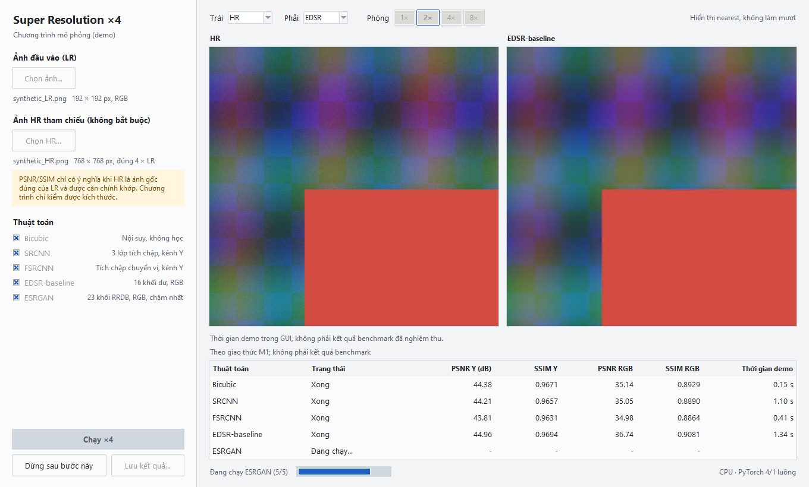
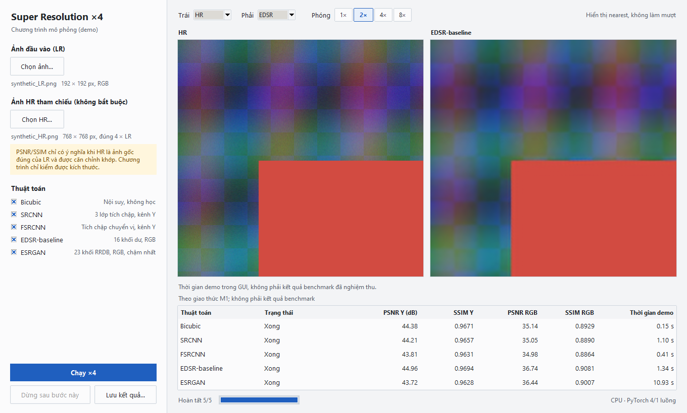

# Hướng dẫn GUI Tkinter

GUI là chương trình minh họa năm thuật toán tăng độ phân giải ảnh ×4: Bicubic, SRCNN, FSRCNN, EDSR-baseline và Original ESRGAN. Giao diện gồm vùng chọn đầu vào, hai khung ảnh đồng bộ và bảng kết quả. GUI tái sử dụng các quy trình đã khóa; các lệnh CLI hiện có vẫn là công cụ benchmark chính thức. Bản hướng dẫn và bằng chứng giai đoạn 2 đang được trình review, chưa thay thế việc nghiệm thu toàn bộ GUI.

## Chuẩn bị và chạy

Chạy từ thư mục gốc của repository với Python 3.12 và môi trường `.venv`. Thực hiện phần cài đặt `requirements.txt`, `requirements-m2-cpu.txt` và `pip check` trong [README](../README.md). GUI dùng Tkinter có sẵn trong bản Python Windows, Pillow, NumPy và PyTorch CPU; không cần cài thư viện GUI mới.

Chuẩn bị checkpoint theo README: dùng `scripts/download_models.py --item srcnn`, `--item edsr`, `--item esrgan`, rồi trích trọng số SRCNN ×4 bằng `scripts/inspect_checkpoint.py data/quarantine/srcnn/SRCNN_v1.zip --extract-x4`. Bicubic không cần trọng số. FSRCNN được tải thủ công từ [yaBorn, commit c6b50c5](https://raw.githubusercontent.com/yaBorn/Super-resolution/c6b50c57f33b044eed1b4d5c20344848842d65e9/mat_FSRCNN/Model/FSRCNN/FSRCNN/x4.mat), lưu đúng `data/quarantine/fsrcnn/yaBorn_c6b50c5_FSRCNN_x4.mat` và kiểm SHA-256 đầy đủ theo README. Không có item tải FSRCNN tự động. Xem [nguồn và giới hạn trọng số](MODELS_PROVENANCE.md); GUI không làm tăng mức xác minh nguồn gốc hay license của checkpoint.

```powershell
.\.venv\Scripts\python.exe scripts/run_gui.py --check-startup
.\.venv\Scripts\python.exe scripts/run_gui.py
```

Khi đã kích hoạt môi trường đúng, có thể chạy `python scripts/run_gui.py`. Lệnh `--check-startup` xác nhận CPU threads 4/1 rồi thoát. Cửa sổ mặc định 1360 × 820 pixel, tối thiểu 1100 × 700 pixel. Font Segoe UI dùng kích thước pixel tương đương 14/10/9 pt tại 96 DPI để giữ bố cục vật lý ổn định khi Windows thay đổi hệ số DPI.

## Quy tắc xử lý

- Chọn từ một đến năm thuật toán: Bicubic, SRCNN, FSRCNN, EDSR-baseline và Original ESRGAN. Chúng chạy tuần tự qua đúng hàm thư viện đã khóa, không triển khai lại nội suy, mạng, đổi màu hoặc lượng tử.
- Số luồng PyTorch là 4 intra-op và 1 inter-op, đặt một lần ở đầu tiến trình trước tính toán. Registry chỉ giữ tối đa một mạng đã nạp để giới hạn RAM; có thao tác giải phóng bộ nhớ đệm.
- Ảnh xám, RGBA hoặc bảng màu được Pillow chuyển sang RGB **trước** quy trình đã khóa và có thông báo. Với RGBA, phép chuyển RGB loại kênh alpha; đây là chuyển đổi đầu vào được khai báo, không phải thay đổi thuật toán.
- Nếu một chiều LR vượt 256 pixel, phần kiểm đầu vào yêu cầu cảnh báo và xác nhận; không tự giảm kích thước hoặc chặn vĩnh viễn.
- Bộ điều khiển xử lý ảnh ở luồng nền, gửi sự kiện qua hàng đợi. Hàm `after()` của Tk chỉ được gọi từ luồng chính để nhận sự kiện; luồng nền không truy cập widget. Yêu cầu dừng có hiệu lực sau thuật toán đang chạy, không ngắt giữa forward.

## Thao tác và trạng thái

1. Chọn LR bằng nút "Chọn ảnh...", có thể chọn thêm HR bằng "Chọn HR...". Khi chưa có LR, không thể chạy. Tên file, kích thước và thông báo chuyển RGB được hiển thị ở thanh trái.
2. Chọn từ một đến năm thuật toán rồi nhấn "Chạy ×4". Trong khi chạy, các điều khiển đổi cấu hình bị khóa; nút "Dừng sau bước này" vẫn hoạt động. Thanh trạng thái cho biết bước k/N và cấu hình CPU 4/1 luồng.
3. Chọn nguồn ảnh ở hai khung. Zoom 1/2/4/8, con lăn và kéo chuột đều đồng bộ hai khung. LR được trình bày trên lưới SR với hệ số 4; chỉ phần ảnh đang nhìn thấy được dựng bằng nearest. Ảnh hiển thị không được đưa lại vào metric hoặc đường lưu.
4. Khi một thuật toán lỗi, hàng đó có màu lỗi và lý do ngắn; các thuật toán sau tiếp tục. Nhấp đúp hàng lỗi để xem chi tiết kỹ thuật. Nhấp đúp tên thuật toán để xem nguồn. Ví dụ thông báo: "Không đủ RAM. Hãy chọn ảnh nhỏ hơn hoặc ít thuật toán hơn." hoặc "Thiếu checkpoint. Xem scripts/download_models.py.".
5. Khi hoàn tất, chọn kết quả rồi nhấn "Lưu kết quả...". GUI tạo thư mục mới cho thuật toán đã chọn, không ghi đè thư mục đã tồn tại. Đóng cửa sổ khi đang xử lý sẽ đợi bước hiện tại kết thúc.

Phím tắt: Ctrl+O chọn LR, Ctrl+H chọn HR, Ctrl+Enter chạy, Ctrl+S lưu, Esc dừng sau bước hiện tại; phím 1/2/4/8 chọn zoom.

## Nhãn và giới hạn chỉ số

**Thời gian demo trong GUI, không phải kết quả benchmark đã nghiệm thu.** Đây là một lần xử lý minh họa, không warm-up/lặp lấy median/IQR và không thay kết quả đã công bố.

**Theo giao thức M1; không phải kết quả benchmark.** PSNR/SSIM chỉ tính khi có HR cùng kích thước SR, đúng 4 lần LR theo mỗi chiều. Không tự cắt hoặc resize cặp tham chiếu.

Dòng "Theo giao thức M1; không phải kết quả benchmark" hiện ngay dưới ghi chú thời gian khi HR có kích thước hợp lệ. Khi không có HR hoặc sai kích thước, dòng này để trống và các ô metric là "-". Metric được tính từ ảnh RGB uint8 gốc của quy trình, chuyển Y theo BT.601, bỏ viền 4 pixel và dùng cấu hình M1 đã công bố; không tính trên ảnh hiển thị đã zoom. Ảnh quá nhỏ cho SSIM cũng có thể không tính được metric và được báo rõ.

**PSNR/SSIM chỉ có ý nghĩa khi HR là ảnh gốc đúng của LR và được căn chỉnh khớp. Chương trình chỉ kiểm được kích thước.** Các hàm kiểm kích thước không chứng minh nội dung hoặc alignment. Cảnh báo này xuất hiện trong vùng màu vàng khi đã chọn HR. HR sai kích thước không được dùng tính metric; bảng hiển thị dấu "-".

Thiếu hoặc sai checkpoint phải báo lỗi rõ; SHA-256 không khớp thì từ chối chạy. FSRCNN là bản đăng lại và ESRGAN dùng kiến trúc Original ESRGAN với checkpoint BasicSR chuyển đổi. Nhãn nguồn giữ nguyên các giới hạn về nguồn gốc, license và chuỗi chuyển đổi.

## File lưu kết quả

Mỗi lần lưu tạo `SR.png` từ RGB uint8 chưa qua biến đổi hiển thị và `metadata.json`. JSON gồm:

- Thuật toán, hệ số ×4, SHA-256 checkpoint và nhãn nguồn.
- Tên/đường dẫn đầu vào, HR nếu có, SHA-256 file và mảng RGB, kích thước, thông báo chuyển mode.
- SHA-256 file và mảng RGB đầu ra, kích thước đầu ra.
- Metric Y/RGB nếu tính được, thông báo metric, nhãn giao thức và cảnh báo HR.
- `demo_seconds`, nhãn thời gian demo, phiên bản Python và thư viện.

Trong metadata GUI, PSNR dương vô hạn được ghi bằng chuỗi `"Infinity"`; metric không tính được có giá trị `null`. Không ghi số Infinity không hợp lệ trong JSON. Đường dẫn trong metadata phục vụ truy vết cục bộ; kiểm tra trước khi chia sẻ file này. Ảnh có pixel Set5 hoặc phái sinh từ Set5 chỉ dùng nội bộ học thuật, không đưa lên GitHub công khai.

## Bằng chứng và kiểm thử

Giai đoạn 1 dùng ảnh tổng hợp và hai ảnh Set14 đã dùng ở sanity. Các script `sanity_srcnn_set14.py`, `sanity_fsrcnn_set14.py`, `sanity_edsr_set14.py`, `sanity_esrgan_set14.py` được chạy nguyên trạng như subprocess; Bicubic dùng CLI hiện có trên cặp ngoài Set5. Cả 15 cặp thuật toán/ảnh lưu qua GUI khớp từng pixel với CLI.

Giai đoạn 2 chỉ chạy một lượt đối chiếu Set5 qua ứng dụng: 5 ảnh × 5 thuật toán, không warm-up và không dùng thời gian demo để phân tích tốc độ. Cả 25 PNG RGB uint8 khớp từng pixel với các run đã khóa. Sai khác tuyệt đối lớn nhất ở từng cột PSNR Y, SSIM Y, PSNR RGB và SSIM RGB so với bảng CSV đầy đủ độ chính xác đều bằng 0. Đây là kiểm chứng tính tương đương GUI, không phải benchmark mới.

G-T4 dùng backend giả chậm để kiểm heartbeat `after()`. Các test cửa sổ thật kiểm chạy, dừng, phím tắt, zoom, kéo ảnh, cảnh báo, lỗi tiếp tục hàng đợi và lưu không ghi đè. Ảnh chụp công khai bên dưới dùng toàn bộ mô hình thật; không dùng backend giả.

```powershell
.\.venv\Scripts\python.exe -m pytest -q --require-set5
```

### Ảnh chụp công khai, chỉ dùng ảnh tổng hợp

HR tổng hợp được tạo xác định bằng gradient màu, kết cấu hình học, hai hình chữ nhật và nhiễu có seed; LR sinh từ HR bằng `degradation.make_lr` của M1. HR 768 × 768 và LR 192 × 192 được căn chỉnh. Các metric hữu hạn trong hình chỉ minh họa hoạt động trên cặp tổng hợp, không phải kết quả thực nghiệm Set5.





Ảnh chụp Set5 chỉ lưu nội bộ để biên tập báo cáo; không có trong tài liệu công khai này. Ảnh nội bộ chọn cố định `img_003` trước khi xem kết quả đối chiếu GUI, không chọn theo chất lượng ảnh.

## Hạn chế

Chỉ chạy CPU, FP32, batch 1 và PyTorch 4/1 luồng; không có chức năng CUDA trong GUI. Thời gian demo bao quanh lời gọi registry và có thể gồm nạp checkpoint lần đầu. Không warm-up/lặp lấy median/IQR; không dùng thời gian này để suy ra tốc độ benchmark, tốc độ GPU hoặc chi phí từng bước.

Bộ điều khiển giải phóng model sau mỗi lượt chạy và sau lỗi; ảnh SR vẫn có thể chiếm RAM. Không ngắt forward đang chạy. Ảnh lớn có thể hết RAM dù đã cảnh báo, và không bảo đảm Windows trả RAM về ngay sau giải phóng. Cảnh báo và kiểm kích thước HR không xác minh được nguồn gốc, nội dung hay căn chỉnh ảnh. Việc GUI khớp CLI không xác minh thêm nguồn checkpoint, phương pháp tạo LR SelfExSR hay chất lượng cảm nhận của ảnh GAN.
