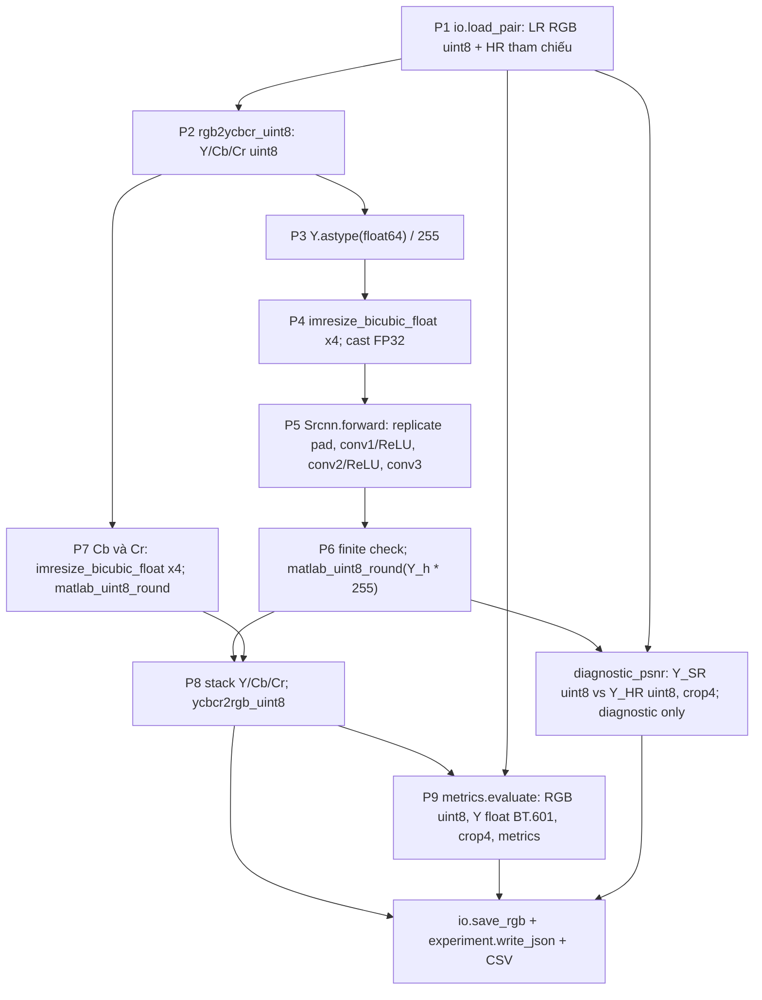

# SRCNN 9-5-5 ImageNet ×4: protocol và kết quả

<!-- LOCKED_CONFIG_BEGIN -->
## Cấu hình đã khóa

Mô hình: SRCNN 9-5-5 ImageNet ×4, trọng số tác giả, 57,281 tham số.
Checkpoint: `data/checkpoints/srcnn/SRCNN/model/9-5-5(ImageNet)/x4.mat`.
SHA-256 tự tính:
`3f94150d24e5b60dab2b74f4eaf358aefdc72cbe724d86990435bf877ed452ed`.
Nguồn archive, layout và điều khoản: [MODELS_PROVENANCE.md](MODELS_PROVENANCE.md).
Không chọn checkpoint hoặc protocol bằng điểm Set5/Set14.

### Pipeline P1–P9

| Bước | Thực hiện đã khóa |
|---|---|
| P1 | Đọc 5 cặp LR/HR SelfExSR RGB uint8 bằng `io.load_pair`, yêu cầu HR=4×LR, không tự sửa cặp |
| P2 | `matlab_color.rgb2ycbcr_uint8`: Y=16+(65.481R+128.553G+24.966B)/255; Cb=128+(-37.797R-74.203G+112B)/255; Cr=128+(112R-93.786G-18.214B)/255; R,G,B thang 0–255; lượng tử uint8 |
| P3 | Lấy Y uint8 và chia 255 thành float64 |
| P4 | `matlab_resize.imresize_bicubic_float` ×4, Keys a=-0.5, tâm pixel 1-based/half-pixel, mở rộng đối xứng gồm pixel biên, hàng rồi cột; không clip/round; cast FP32 cho mạng |
| P5 | `Srcnn.forward`: conv 1→64 k9 pad replicate4 + ReLU; 64→32 k5 pad replicate2 + ReLU; 32→1 k5 pad replicate2, không activation; conv2d padding0/correlation; FP32 |
| P6 | Kiểm Y_h hữu hạn trước lượng tử, nhân 255, half away from zero rồi bão hòa uint8; giữ Y_SR uint8 cho cột chẩn đoán |
| P7 | Bicubic float ×4 riêng từng kênh Cb/Cr từ uint8, chỉ clip/round sau nội suy |
| P8 | Ghép Y_SR/Cb/Cr uint8, nghịch đảo chính xác ma trận P2 bằng float64, clip/round half away from zero sang RGB uint8 |
| P9 | Nguyên `metrics.evaluate` M1: RGB uint8 → Y float BT.601 → crop 4 mỗi cạnh → metric; RGB bổ sung; data_range255, SSIM Gaussian11×11 σ1.5, K1=.01/K2=.03, population covariance |

Mạng dùng `reshape(order='F')` để chuyển kernel MATLAB sang OIHW, nạp
`strict=True`, `eval()` và `torch.inference_mode()`. Biên đối xứng của
resize khác padding replicate trong mạng. Không gọi Bicubic M1 trong P4/P7.
Y float chính có studio range16–235 nhưng dùng peak255 theo protocol M1.
Mean Set5 là trung bình cộng per-image, không gộp MSE để suy ra PSNR.

### Khác biệt K1–K6 với demo MATLAB tác giả

| Mã | Khác biệt và giới hạn |
|---|---|
| K1 | Demo đổi HR RGB→Y uint8, chuẩn hóa rồi tạo LR Y single chưa lượng tử bằng imresize; ở đây nhận LR RGB uint8 SelfExSR rồi mới lấy Y uint8. Đảo thứ tự màu/giảm mẫu và có thêm lượng tử; không tương đương toàn bộ demo |
| K2 | Công cụ tạo LR SelfExSR còn UNVERIFIED; không suy ra MATLAB từ kích thước/pixel gần nhau |
| K3 | Demo chỉ xử lý Y; bicubic CbCr và ảnh RGB ở đây là quy ước bổ sung cho protocol chung |
| K4 | Demo tính PSNR trên Y uint8 sau shave4. Kết quả chính ở đây tính Y float từ SR RGB uint8. Y_SR(P6)→RGB uint8→Y float thêm sai số. PSNR trực tiếp Y_SR uint8 so Y_HR uint8, crop4, peak255 chỉ là chẩn đoán, không xếp hạng/trộn bảng chính |
| K5 | Demo MATLAB dùng single ở đầu và double cho trung gian; ở đây preprocessing float64, mạng toàn FP32. T2 định lượng sai khác |
| K6 | Quy tắc MATLAB dựa trên tài liệu, chưa có MATLAB runtime oracle. Rủi ro chênh một mức ở biên làm tròn vẫn còn; không tuyên bố tương thích MATLAB thực nghiệm |

### D1–D5

| Quyết định | Nội dung |
|---|---|
| D1 | Một pipeline P1–P9 đã khóa; main metric qua RGB uint8/M1; K4 diagnostic riêng; không chạy nhiều preprocessing để chọn score |
| D2 | Timing chính toàn P2–P8; phụ chỉ P5 trên tensor đã chuẩn bị |
| D3 | CPU, FP32, batch1; 4 intra-op/1 inter-op, đặt một lần đầu tiến trình; không đổi trong run |
| D4 | Sanity Set14 theo hợp lệ, ổn định và alignment; không yêu cầu vượt Bicubic; không dùng score để chọn |
| D5 | Không sửa module M1, checkpoint, golden, metric hoặc timing baseline |

### Ngưỡng T1–T9 và kết quả giai đoạn 1

Các ngưỡng dưới đây được cố định trước phép đo Set5.

| Test | Ngưỡng/tiêu chí | Kết quả thực tế giai đoạn 1 |
|---|---|---|
| T1 | Shape/biến/hash/bias và 57,281 tham số khớp tuyệt đối | PASS |
| T2 | max abs ≤1e-4 trên [0,1], ≥5 mẫu gồm hai crop Set14; NumPy float64 độc lập | PASS 7 mẫu; max lớn nhất9.177501054669079e-7; xem bảng chi tiết dưới đây |
| T3 | Impulse layout column-major đúng; row-major sai | PASS peak(14,12) và negative control(10,16) |
| T4 | Hằng số khớp tính tay ≤1e-6; ảnh cạnh sát biên khớp T2 | PASS hằng số5.9604645e-8; cạnh6.332375578899097e-7 trong T2 |
| T5 | RGB uint8, kích thước4H×4W, LR lẻ/không vuông | PASS; thêm test NaN Y_h bị từ chối trước lượng tử |
| T6a | Float resize vs contributions độc lập ≤1e-9; biên1–2pixel, hằng số, reject scale<1 | PASS max0 trên5shape |
| T6b | Tuyến tính và chia255 trước/sau ≤1e-12 float64; ép FP32 ≤1e-6 | PASS2.7755575615628914e-16 /2.6020852139652106e-18; FP32 5.024609683879078e-8 |
| T7a | Float color roundtrip ≤1e-9 | PASS1.1368683772161603e-13 |
| T7b | Đen/trắng/R/G/B→(16,128,128)/(235,128,128)/(81,90,240)/(145,54,34)/(41,240,110) tuyệt đối | PASS |
| T7c | RGB grid{0,5,…,255}³, max roundtrip≤2 mức | PASS: abs0=257945, abs1=163389, abs2=490 kênh; chỉ kết luận trên grid này |
| T7d | Mẫu inverse độc lập từ hệ số1.164383/1.596027/.391762/.812968/2.017232; 8 mẫu trong test phải khớp tuyệt đối | PASS, không dùng inverse implementation để sinh expected |
| T7e | Half-away/saturation trên11giá trị đã khóa, NaN/Inf báo lỗi | PASS |
| T8 | Pytest required Set5 và crosscheck M1 trước/sau thêm code | PASS46trước/64sau; crosscheck5/5 cả hai, mean28.43175155/.81126246 |
| T9(1–4) | Output hợp lệ/hữu hạn; hai lần cùng process bằng nhau; raw pixel hash+shape+dtype bằng process mới; known shift(+3,-2)/(0,0) đúng, pipeline lag0±1 | PASS synthetic,zebra,monarch; tất cả pipeline lag(0,0) |
| T9(5–7) | Cảnh báo Pearson<.95, HR correlation lag ngoài0±1, hoặc sọc/khối/nhiễu khi xem ảnh | Không cảnh báo số; xem trực quan zebra/monarch full/crop: PASS, không thấy bất thường màu/hình học/sọc/khối |

T9 Pearson so với Y Bicubic: zebra .9704956823455774; monarch
.9799491685115699; synthetic .991055346861981; lag với HR đều(0,0).
Clip Y_h<0 ở zebra .007502471402344301%, >1 là0%; monarch/synthetic
đều0% cả hai phía. PSNR/SSIM Set14 chỉ ghi nhận, không tiêu chí lựa chọn.
Ảnh và report sanity là artifact cục bộ `logs/m3_t9/`, không có trong Git.

T2 sai khác max/mean so với bản dịch NumPy độc lập:

| Mẫu | max abs | mean abs |
|---|---|---|
| noise | 9.177501054669079e-7 | 2.3510833155486677e-7 |
| gradient | 8.979065919678675e-7 | 1.7753929897010388e-7 |
| checker | 5.992693808409832e-7 | 1.768566206174149e-7 |
| constant | 5.078500764366112e-8 | 5.078500764366112e-8 |
| edge | 6.332375578899097e-7 | 1.616635033424574e-7 |
| zebra crop | 6.959415840279704e-7 | 2.021185631014027e-7 |
| monarch crop | 6.741516234143319e-7 | 1.642154283317015e-7 |

### Timing đã khóa

CPU i7-1185G7; FP32, batch1; `timing.measure` M1 bằng perf_counter_ns,
3warm-up +10mẫu cho mỗi ảnh và mỗi phạm vi. Chính: `super_resolve` toàn
P2–P8, gồm tiền/hậu xử lý và lượng tử. Phụ: chỉ `model(tensor)` P5 với
tensor đã chuẩn bị, bên trong inference_mode. Không tính I/O, nạp checkpoint,
metric hoặc chuẩn bị tensor ở timing phụ. Giữ mọi mẫu, báo median và IQR(ms).
Một forward riêng tạo output để tính metric trước hai phép timing; không
coi forward này là mẫu đo. Thread4/1 đặt một lần đầu tiến trình.
Bicubic M1 giữ nguyên run3+30mẫu, không chạy lại timing.
<!-- LOCKED_CONFIG_END -->

## Receipt và lần chạy

Cấu hình được tạo trước lần suy luận SRCNN Set5 đầu tiên. Receipt cục bộ
`logs/m3_lock.log`: **2026-11-08T20:16:29.886552+00:00**.
`METRICS_RUN_START`: **2026-11-08T20:16:41.418408+00:00**.
Run duy nhất: `set5_srcnn955_x4_20261108_201641`. Receipt đi trước run;
script xác minh lại source và phần khóa trước khi suy luận. Không chạy lại
để cải thiện score hoặc bỏ mẫu timing.

| Nội dung khóa | SHA-256 |
|---|---|
| srcnn.py | `24f4ea085583586ea213567c4f3fb2a060270c70a9c6aa3de65b62bda650d4a4` |
| matlab_resize.py | `99f09bbb9a76257ebda5098734f74b131a2d6e584e3782321088ae74ee3bef4e` |
| matlab_color.py | `4046810cb6b3b3771ac2adef9935dcac5a2f96865cc6e37b3c376fd00f8862d1` |
| run_srcnn.py | `141149bd5365bd51dc4e28bd59257b0b483ed202c9398761ccec878b6eac0ac8` |
| Văn bản UTF-8 giữa hai marker khóa | `90e3703c167c55cb36611f757d0b69ea2561439f4e395bd692f698838ff3c0c1` |

Các log là bằng chứng cục bộ, không công bố trong repository. Bốn source
và phần khóa không bị sửa sau receipt; chỉ bổ sung kết quả ngoài phần khóa.

## Lưu đồ L3 khớp implementation

HR chỉ dùng cho kiểm kích thước và đánh giá, không đưa vào mạng. Timing
chính bao quanh `super_resolve` P2–P8; timing phụ bao quanh P5 sau
`prepare_forward`. Nạp trọng số và đọc/ghi file nằm ngoài cả hai phạm vi.

## Kiểm tra sau lần chạy

- `pytest -q --require-set5`: **65 passed**, gồm test script trên dữ liệu
  tổng hợp (không dùng checkpoint thật), giữ output độc quyền và JSON-safe
  với PSNR vô hạn.
- Crosscheck độc lập Bicubic: **PASS 5/5**, mean Y
  **28.43175155 / 0.81126246**; không đo lại timing M1.
- Đọc lại 5 SR PNG, dùng nguyên `metrics.evaluate` tính MSE/PSNR/SSIM Y
  và RGB: sai khác tuyệt đối lớn nhất **0.0**, dung sai kiểm **1e-9**.
  Kiểm CSV/JSON/mean, đủ 10 mẫu mỗi phạm vi và median/IQR tính lại: PASS.
- Bảng dưới đây sinh bằng `logs/m3_s2_report.py` từ JSON của hai run thật;
  helper và log chi tiết chỉ lưu cục bộ. Không dùng helper này chạy model.

Trước implementation script, test mới có một lần RED dự kiến do file chưa
tồn tại, sau đó PASS khi viết code; không xóa lịch sử test RED. Giai đoạn 1
cũng giữ các log RED khi ba module mới và script sanity chưa tồn tại. Đây
là kiểm chứng theo TDD, không phải kết quả kiểm ngưỡng bị chỉnh để đạt.

## Hạn chế và nguồn

Không có MATLAB oracle, tồn tại K1–K6. License trọng số không nêu riêng;
Readme SRCNN giới hạn học thuật, không thương mại/công nghiệp, yêu cầu trích
dẫn. SHA-256 là tự tính, không phải checksum độc lập tác giả công bố.

Số tham khảo TPAMI Set5×4: **chưa trích được**. Đã thử đọc
[bài SRCNN arXiv:1501.00092](https://arxiv.org/pdf/1501.00092), nhưng công
cụ đọc từ chối PDF 10,894,358 byte do quá dung lượng. Không điền số từ trí
nhớ, không dùng số tác giả làm tiêu chí pass/fail.

## Kết quả Set5 từ artifact thực tế

Run_id: `set5_srcnn955_x4_20261108_201641`; input 5 cặp SelfExSR cố định; đọc số từ `results/set5_srcnn955_x4_20261108_201641/metrics.json` và đối chiếu CSV/PNG. Artifact không được commit.

| Ảnh | PSNR Y (dB) | SSIM Y | PSNR RGB (dB) | SSIM RGB | PSNR K4 diagnostic (dB) |
|---|---|---|---|---|---|
| img_001_SRF_4 | 33.10591833 | 0.88198473 | 31.53115910 | 0.85310595 | 33.10060075 |
| img_002_SRF_4 | 32.52308254 | 0.91108920 | 29.84322918 | 0.87161497 | 32.50044780 |
| img_003_SRF_4 | 25.45199801 | 0.85636052 | 24.05610477 | 0.82824247 | 25.44482317 |
| img_004_SRF_4 | 32.44167277 | 0.78009704 | 29.46107439 | 0.69864576 | 32.42270634 |
| img_005_SRF_4 | 28.88051999 | 0.88327313 | 27.51247181 | 0.86780413 | 28.87625948 |
| Mean per-image | 30.48063833 | 0.86256093 | 28.48080785 | 0.82388266 | 30.46896751 |

K4 chỉ là chẩn đoán uint8-Y; không xếp hạng hoặc thay thế kết quả chính Y float từ RGB uint8.

### So với Bicubic M1

| Ảnh | Bicubic PSNR Y | SRCNN − Bicubic PSNR Y (dB) | Bicubic SSIM Y | SRCNN − Bicubic SSIM Y |
|---|---|---|---|---|
| img_001_SRF_4 | 31.78644620 | +1.31947213 | 0.85765643 | +0.02432830 |
| img_002_SRF_4 | 30.18703920 | +2.33604334 | 0.87380864 | +0.03728056 |
| img_003_SRF_4 | 22.10101285 | +3.35098516 | 0.73748384 | +0.11887668 |
| img_004_SRF_4 | 31.61503165 | +0.82664113 | 0.75466398 | +0.02543306 |
| img_005_SRF_4 | 26.46922783 | +2.41129216 | 0.83269942 | +0.05057371 |
| Mean per-image | 28.43175155 | +2.04888678 | 0.81126246 | +0.05129846 |

### Timing CPU (ms)

| Ảnh | SRCNN P2–P8 median/IQR | SRCNN P5 median/IQR | Bicubic M1 median/IQR |
|---|---|---|---|
| img_001_SRF_4 | 421.809350 / 38.730375 | 312.902700 / 41.288650 | 66.837000 / 40.524875 |
| img_002_SRF_4 | 129.934400 / 6.793050 | 117.318850 / 6.141250 | 15.689000 / 0.956925 |
| img_003_SRF_4 | 121.582750 / 16.175375 | 85.115400 / 8.809525 | 12.283550 / 3.043850 |
| img_004_SRF_4 | 138.799350 / 14.344500 | 91.817400 / 5.460725 | 18.047200 / 6.947300 |
| img_005_SRF_4 | 138.253900 / 26.539425 | 103.704450 / 17.477925 | 15.538200 / 2.734225 |

SRCNN: mỗi phạm vi/mỗi ảnh 3 warm-up + 10 mẫu, không bỏ mẫu. Bicubic: artifact M1 `set5_numpy_x4_20261108_1627`, 3 warm-up + 30 mẫu, không chạy lại. Hai cột SRCNN là hai phép đo riêng, không lấy hiệu để suy ra chi phí từng bước. Khác số mẫu, thời điểm, phạm vi và cấu hình thread làm hạn chế so sánh; không suy ra speedup chung hoặc gán Bicubic CUDA.

CPU `11th Gen Intel(R) Core(TM) i7-1185G7 @ 3.00GHz`; RAM 16889188352 byte; OS `Windows-10-10.0.19045-SP0`; Python 3.12.10; torch 2.10.0+cpu; CPU/FP32/batch 1; threads 4/1. OMP_NUM_THREADS/MKL_NUM_THREADS/OPENBLAS_NUM_THREADS đều không đặt. Chi tiết trong environment.json.

### Nhận xét từng ảnh

- **img_001_SRF_4**: PSNR Y tăng 1.31947213 dB và SSIM Y tăng 0.02432830. Ảnh SR có vùng da tương đối trơn, cạnh mắt/miệng và kết cấu mũ len. Giả thuyết: ánh xạ phi tuyến học từ dữ liệu hỗ trợ một phần đáp ứng biên/kết cấu này; tăng điểm không đồng nghĩa từng sợi len đã được phục hồi đúng. Giới hạn: metric toàn ảnh chưa định vị lỗi; K1–K6 và thiếu MATLAB oracle vẫn áp dụng.
- **img_002_SRF_4**: PSNR Y tăng 2.33604334 dB và SSIM Y tăng 0.03728056. Ảnh SR có biên mỏ/thân chim và nhiều cạnh lá phía sau. Giả thuyết: mô hình học được đáp ứng cạnh định hướng tốt hơn kernel cubic cố định; metric gộp chưa tách đóng góp của chim và nền. Giới hạn: metric toàn ảnh chưa định vị lỗi; K1–K6 và thiếu MATLAB oracle vẫn áp dụng.
- **img_003_SRF_4**: PSNR Y tăng 3.35098516 dB và SSIM Y tăng 0.11887668. Ảnh cánh bướm có nhiều đường viền đen và mảng màu tương phản. Đây là mức tăng PSNR lớn nhất trong năm ảnh. Giả thuyết: ánh xạ phi tuyến bổ sung đáp ứng tần số cao ở các biên này; không suy từ PSNR rằng mọi chấm/vân cánh đều đúng HR. Giới hạn: metric toàn ảnh chưa định vị lỗi; K1–K6 và thiếu MATLAB oracle vẫn áp dụng.
- **img_004_SRF_4**: PSNR Y tăng 0.82664113 dB và SSIM Y tăng 0.02543306. Ảnh gương mặt nghiêng có vùng da chuyển sắc trơn, tóc và cạnh mặt. Đây là mức tăng PSNR nhỏ nhất trong năm ảnh. Giả thuyết: nội suy đã mô tả được phần chuyển sắc nên phần lợi ích học phi tuyến ở biên có tỷ trọng nhỏ hơn; cần kiểm crop mới xác định được nguyên nhân. Giới hạn: metric toàn ảnh chưa định vị lỗi; K1–K6 và thiếu MATLAB oracle vẫn áp dụng.
- **img_005_SRF_4**: PSNR Y tăng 2.41129216 dB và SSIM Y tăng 0.05057371. Ảnh chân dung có cạnh mắt/lông mày, ngón tay và họa tiết mũ. Giả thuyết: đáp ứng cạnh/kết cấu học từ dữ liệu hỗ trợ tăng metric; không đồng nhất tăng điểm với phục hồi trung thực mọi họa tiết hoặc cảm nhận sắc nét. Giới hạn: metric toàn ảnh chưa định vị lỗi; K1–K6 và thiếu MATLAB oracle vẫn áp dụng.

Cải thiện PSNR Y lớn nhất: `img_003_SRF_4`; nhỏ nhất: `img_004_SRF_4`. Đây là mô tả 5 ảnh, không phải bằng chứng tổng quát cho dataset khác hoặc một quy luật về texture. K1–K6 và sai số lượng tử/chroma giới hạn diễn giải.
