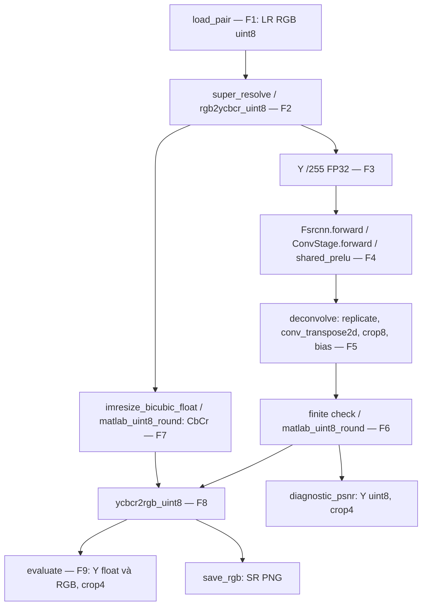

# FSRCNN(56,12,4) ×4 — cấu hình và kết quả Set5

<!-- LOCKED_CONFIG_BEGIN -->
## Cấu hình đã khóa trước thực nghiệm

Trọng số lấy từ bản đăng lại của gói FSRCNN_test (Chao Dong, ECCV 2016); hai bản sao độc lập trùng SHA-256; nguồn gốc trực tiếp từ CUHK và cách chọn checkpoint chưa được xác minh; chỉ sử dụng cho mục đích học thuật.

- Checkpoint tại chỗ: `data/quarantine/fsrcnn/yaBorn_c6b50c5_FSRCNN_x4.mat`.
- SHA-256: `af005f2ba6e90ef45f1807045c3f78132e15b57d9056e4691c79e34863dbdd4f`. Đây là checksum tự tính, không phải checksum tác giả công bố.
- 12.644 tham số: conv 5×5 1→56; conv 1×1 56→12; bốn conv 3×3 12→12; conv 1×1 12→56; deconv 9×9 56→1, stride 4. Bảy conv giữ kích thước bằng replicate padding 2/0/1/1/1/1/0; mỗi lớp có một PReLU scalar chung, kể cả slope âm. Bias cộng trước PReLU. Lớp 8 không activation.
- Layout conv: `W[o,i] = M[i,:,o].reshape(k,k,order='F')`; deconv `[56,1,9,9]`, không lật kernel.
- F-D5: replicate pad 1 quanh feature → `conv_transpose2d(stride=4,padding=0,output_padding=0,bias=None)` → crop `[8:8+4H,8:8+4W]` → cộng bias cuối một lần. Buffer tự nhiên nhỏ hơn MATLAB 3 hàng/cột cuối nằm ngoài crop.

| Bước | Pipeline cố định |
|---|---|
| F1 | `io.load_pair`: đúng 5 cặp RGB uint8 Set5 SelfExSR ×4, không crop/resize cặp benchmark |
| F2 | `rgb2ycbcr_uint8` kiểu MATLAB |
| F3 | Y uint8 /255 → FP32, trực tiếp kích thước LR |
| F4 | Bảy conv + shared PReLU |
| F5 | Deconv F-D5, không bicubic trước mạng |
| F6 | Kiểm NaN/Inf trên Y float; nhân 255, `matlab_uint8_round` (half away from zero, bão hòa) |
| F7 | CbCr LR → `imresize_bicubic_float` ×4 → lượng tử MATLAB uint8 |
| F8 | `ycbcr2rgb_uint8`, SR RGB uint8 |
| F9 | `metrics.evaluate` nguyên M1: Y float BT.601 và RGB, crop 4, data_range 255 |

Y chính: `16 + (65.481R + 128.553G + 24.966B)/255`, giữ float64 sau RGB uint8. SSIM Gaussian 11×11, σ=1,5; K1=0,01; K2=0,03; population covariance. Chẩn đoán riêng: PSNR Y_SR uint8 với Y_HR uint8 kiểu MATLAB, crop 4; không thay metric chính. Trung bình là trung bình cộng per-image.

### Khác biệt so với demo MATLAB

- KF1: SelfExSR LR RGB uint8 khác LR do demo giảm mẫu Y float từ HR.
- KF2: công cụ tạo LR SelfExSR chưa xác minh.
- KF3: CbCr bicubic và ghép RGB là quy ước của chương trình; demo chỉ Y.
- KF4: metric chính trên Y float từ RGB đã lượng tử; Y uint8 trực tiếp chỉ chẩn đoán.
- KF5: PyTorch FP32 so với số học MATLAB và bản dịch NumPy float64.
- KF6: hành vi hàm màu/lượng tử lấy từ tài liệu; chưa có MATLAB runtime oracle. Không tái khẳng định thân các hàm phụ MATLAB chưa đọc.
- KF7: checkpoint đăng lại, nguồn gốc trực tiếp CUHK và quy trình chọn checkpoint chưa xác minh.
- KF8: Readme của gói ghi MATLAB là bản tái hiện; bài báo dùng C++, kết quả có thể khác nhẹ. Demo mặc định ×3; ở đây cố định checkpoint ×4.

### Kiểm thử trước benchmark

| Test | Ngưỡng và kết quả giai đoạn 1 |
|---|---|
| F-T1 | Hash/schema/dtype khớp tuyệt đối; 12.644 tham số, 23 keys; PASS |
| F-T2 | Toàn output NumPy float64–PyTorch FP32, max ≤1e-4 trên [0,1]; 6 mẫu nhiễu/gradient/bàn cờ/hằng/zebra/monarch, có kích thước lẻ và không vuông; max quan sát 2,263617491338188e-6; Y uint8 khác 0 pixel; PASS |
| F-T3 | Kernel bất đối xứng và nhãn kênh khớp tuyệt đối; sai row-major/flip/layout đều gây max sai khác 1; PASS |
| F-T4 | Tính tay cả 7 lớp conv/PReLU ≤1e-6, thực tế 0; kiểm slope âm lớp 1 và 7, bias trước activation và lớp 8 không activation; PASS |
| F-T5 | Hình học 0/1 exact, impulse giữa/biên/góc, 1×1/1×N/N×1/lẻ; crop7/crop9/bỏ replicate/direct p4 op3 đều bị phát hiện, max sai khác 5–8; PASS |
| F-T6 | Test màu/resize M3 nguyên trạng; PASS |
| F-T7 | 93 tests PASS, crosscheck Bicubic 5/5; 10 ảnh SR SRCNN/EDSR không đổi hash; PASS |
| F-T8 | Set14 và synthetic hợp lệ, deterministic cùng/khác tiến trình bằng hash pixel thô + shape + dtype; shifts (+3,−2)/(0,0) đúng; Pearson synthetic/zebra/monarch 0,9911735238/0,9718252768/0,9802628435; lag HR (0,0). Cảnh báo nếu Pearson <0,95 hoặc lag ngoài ±1. Kiểm tra trực quan đạt; không cảnh báo |

### Timing đã khóa

CPU, FP32, batch 1, `torch.set_num_threads(4)` và `set_num_interop_threads(1)` một lần đầu tiến trình; 3 warm-up + 10 lần đo, không bỏ mẫu. Chính: `super_resolve` F2–F8, gồm chuyển màu/resize chroma/lượng tử; phụ: chỉ `model(tensor)` F4–F5, tensor chuẩn bị sẵn. Dùng `timing.measure`/`perf_counter_ns`, median và IQR; loại I/O, load checkpoint và metric. Hardware, 22 dependency pins, thread/environment và hash source được lưu trong receipt trước `METRICS_RUN_START`. Không thay cấu hình theo điểm số.
<!-- LOCKED_CONFIG_END -->

## Kết quả thực nghiệm

Run `set5_fsrcnn56124_x4_20261109_043641`; artifacts trong `results/set5_fsrcnn56124_x4_20261109_043641/`: 5 SR PNG, metrics JSON/CSV và environment JSON. Chạy đúng một lần; không bỏ mẫu timing. Ảnh dữ liệu và kết quả không được commit.

Khóa UTC `2026-11-09T04:36:22.415741+00:00`; `METRICS_RUN_START` UTC `2026-11-09T04:36:42.189710+00:00` (cũng ghi trong environment.json). Receipt: `logs/m4_lock.log`, log cục bộ, không công bố trong repository. Hash khối khóa `fd54e81944fcbc85dec3ff0774182af7530f4e35af3973b054c58863349e658c`.

| Source khóa | SHA-256 |
| --- | --- |
| src/sr_compare/fsrcnn.py | d62c2068c9f29e163e51145b79366fdd71a036bb0370e89b18945ca64815303e |
| scripts/run_fsrcnn.py | fb30f38013f3b74dc47fd185da8e667d4bffabd6fe9598289c508e7018b94c85 |
| src/sr_compare/matlab_color.py | 4046810cb6b3b3771ac2adef9935dcac5a2f96865cc6e37b3c376fd00f8862d1 |
| src/sr_compare/matlab_resize.py | 99f09bbb9a76257ebda5098734f74b131a2d6e584e3782321088ae74ee3bef4e |
| src/sr_compare/io.py | c468b61f3dc2cfc4bbf8e3da8010b6604971aff487796d7a1b40b264aaabd48c |
| src/sr_compare/metrics.py | 4d29b4eac0928890532eb2516177ec2f967278e03c6e5727625e20ab8b44b837 |
| src/sr_compare/timing.py | 24bb99f1902fb3e18ec753d3f85e4c908f9c323aa2126a1e30d5236e230a9058 |

CPU 11th Gen Intel(R) Core(TM) i7-1185G7 @ 3.00GHz; RAM 16889188352 byte; OS Windows-10-10.0.19045-SP0; Python 3.12.10; torch 2.10.0+cpu; thread 4/1. OMP/MKL/OPENBLAS đều chưa đặt. Receipt và environment chứa đủ 22 pins.

| Package | Pin |
| --- | --- |
| Jinja2 | 3.1.6 |
| MarkupSafe | 3.0.2 |
| colorama | 0.4.6 |
| filelock | 3.18.0 |
| fsspec | 2025.5.1 |
| imageio | 2.37.0 |
| iniconfig | 2.1.0 |
| lazy_loader | 0.4 |
| mpmath | 1.3.0 |
| networkx | 3.4.2 |
| numpy | 2.2.6 |
| packaging | 25.0 |
| pillow | 11.2.1 |
| pluggy | 1.5.0 |
| pytest | 8.3.5 |
| scikit-image | 0.25.2 |
| scipy | 1.15.3 |
| setuptools | 80.9.0 |
| sympy | 1.14.0 |
| tifffile | 2025.5.10 |
| torch | 2.10.0+cpu |
| typing_extensions | 4.13.2 |

### Metric chính

| Ảnh | MSE Y | PSNR Y | SSIM Y | MSE RGB | PSNR RGB | SSIM RGB |
| --- | --- | --- | --- | --- | --- | --- |
| img_001_SRF_4 | 31.14532158 | 33.19687541 | 0.88066426 | 44.85322709 | 31.61286666 | 0.85125997 |
| img_002_SRF_4 | 34.21925272 | 32.78809840 | 0.91317891 | 65.06469813 | 29.99734942 | 0.87260072 |
| img_003_SRF_4 | 176.90393523 | 25.65342867 | 0.86368453 | 244.72590401 | 24.24400419 | 0.83605949 |
| img_004_SRF_4 | 36.39402120 | 32.52050317 | 0.78156248 | 72.71666847 | 29.51446388 | 0.69986245 |
| img_005_SRF_4 | 75.53743635 | 29.34918120 | 0.88815454 | 103.61910173 | 27.97640538 | 0.87252860 |
| Trung bình | 70.83999342 | 30.70161737 | 0.86544894 | 106.19591989 | 28.66901790 | 0.82646224 |

### Cột chẩn đoán và lượng tử

PSNR Y uint8 trực tiếp là diagnostic, không thay kết quả chính. Tỷ lệ clip tính trên Y float chuẩn hóa trước lượng tử, không phải số RGB bị clip khi đổi màu ngược.

| Ảnh | PSNR Y uint8 diagnostic | Y <0 (%) | Y >1 (%) |
| --- | --- | --- | --- |
| img_001_SRF_4 | 33.19073320 | 0.00000000 | 0.00000000 |
| img_002_SRF_4 | 32.76507587 | 0.00000000 | 0.00000000 |
| img_003_SRF_4 | 25.64413652 | 0.00000000 | 0.00000000 |
| img_004_SRF_4 | 32.49623398 | 0.00000000 | 0.00000000 |
| img_005_SRF_4 | 29.34469436 | 0.00000000 | 0.00000000 |
| Trung bình PSNR | 30.68817479 | — | — |

### So sánh từng ảnh theo metric chính

Mọi Δ dưới đây = FSRCNN − thuật toán tham chiếu. Các run tham chiếu giữ nguyên, không chạy lại.

| Ảnh | Tham chiếu | Δ PSNR Y (dB) | Δ SSIM Y |
| --- | --- | --- | --- |
| img_001_SRF_4 | Bicubic | 1.41042922 | 0.02300783 |
| img_001_SRF_4 | SRCNN | 0.09095708 | -0.00132047 |
| img_001_SRF_4 | EDSR | -0.54438992 | -0.01239145 |
| img_002_SRF_4 | Bicubic | 2.60105919 | 0.03937026 |
| img_002_SRF_4 | SRCNN | 0.26501586 | 0.00208970 |
| img_002_SRF_4 | EDSR | -2.14924977 | -0.03122796 |
| img_003_SRF_4 | Bicubic | 3.55241582 | 0.12620069 |
| img_003_SRF_4 | SRCNN | 0.20143066 | 0.00732401 |
| img_003_SRF_4 | EDSR | -2.78370761 | -0.05869824 |
| img_004_SRF_4 | Bicubic | 0.90547153 | 0.02689849 |
| img_004_SRF_4 | SRCNN | 0.07883040 | 0.00146544 |
| img_004_SRF_4 | EDSR | -0.41837409 | -0.01477698 |
| img_005_SRF_4 | Bicubic | 2.87995337 | 0.05545512 |
| img_005_SRF_4 | SRCNN | 0.46866121 | 0.00488142 |
| img_005_SRF_4 | EDSR | -1.08583567 | -0.02474306 |

### Timing CPU (ms)

| Ảnh | Thuật toán | Median chính | IQR chính | n chính | Median mạng | IQR mạng | n mạng |
| --- | --- | --- | --- | --- | --- | --- | --- |
| img_001_SRF_4 | Bicubic | 66.83700000 | 40.52487500 | 30 | — | — | — |
| img_002_SRF_4 | Bicubic | 15.68900000 | 0.95692500 | 30 | — | — | — |
| img_003_SRF_4 | Bicubic | 12.28355000 | 3.04385000 | 30 | — | — | — |
| img_004_SRF_4 | Bicubic | 18.04720000 | 6.94730000 | 30 | — | — | — |
| img_005_SRF_4 | Bicubic | 15.53820000 | 2.73422500 | 30 | — | — | — |
| img_001_SRF_4 | SRCNN | 421.80935000 | 38.73037500 | 10 | 312.90270000 | 41.28865000 | 10 |
| img_002_SRF_4 | SRCNN | 129.93440000 | 6.79305000 | 10 | 117.31885000 | 6.14125000 | 10 |
| img_003_SRF_4 | SRCNN | 121.58275000 | 16.17537500 | 10 | 85.11540000 | 8.80952500 | 10 |
| img_004_SRF_4 | SRCNN | 138.79935000 | 14.34450000 | 10 | 91.81740000 | 5.46072500 | 10 |
| img_005_SRF_4 | SRCNN | 138.25390000 | 26.53942500 | 10 | 103.70445000 | 17.47792500 | 10 |
| img_001_SRF_4 | EDSR | 486.81235000 | 304.96400000 | 10 | 769.86195000 | 36.81717500 | 10 |
| img_002_SRF_4 | EDSR | 278.61300000 | 34.32262500 | 10 | 248.39010000 | 22.34415000 | 10 |
| img_003_SRF_4 | EDSR | 214.44790000 | 34.40270000 | 10 | 210.28775000 | 25.37507500 | 10 |
| img_004_SRF_4 | EDSR | 253.86940000 | 29.69657500 | 10 | 233.36705000 | 18.73587500 | 10 |
| img_005_SRF_4 | EDSR | 281.19045000 | 51.73947500 | 10 | 247.88300000 | 20.05137500 | 10 |
| img_001_SRF_4 | FSRCNN | 181.94275000 | 15.27577500 | 10 | 40.10815000 | 2.78607500 | 10 |
| img_002_SRF_4 | FSRCNN | 54.76600000 | 2.49637500 | 10 | 14.13315000 | 1.14895000 | 10 |
| img_003_SRF_4 | FSRCNN | 45.76910000 | 2.34145000 | 10 | 12.92890000 | 2.51760000 | 10 |
| img_004_SRF_4 | FSRCNN | 51.52540000 | 3.16857500 | 10 | 15.80720000 | 0.64532500 | 10 |
| img_005_SRF_4 | FSRCNN | 51.58340000 | 7.74315000 | 10 | 14.88525000 | 2.16980000 | 10 |

Bicubic dùng 3 warm-up + 30 lần đo; ba mạng dùng 3 + 10. Cột chính gồm đúng pipeline riêng của mỗi thuật toán; Bicubic không có cột mạng. Cùng máy nhưng các phiên chạy khác thời điểm, tải nền và trạng thái CPU có thể khác; không suy diễn speedup phần cứng hay kiểm định thống kê từ các median. IQR và mọi mẫu gốc giữ trong JSON. Timing EDSR img_001 có median forward lớn hơn pipeline ở hai loạt đo độc lập, đã được ghi nhận ở M5; giữ nguyên, không chạy lại. Không lấy hiệu hai median độc lập làm thời gian chính xác cho từng bước màu/resize.

## Lưu đồ L4

## Phân tích từng ảnh

### img_001_SRF_4

Ở ảnh này, PSNR cao hơn SRCNN nhưng SSIM thấp hơn: không thể gọi là tốt hơn trên cả hai tiêu chí. Giả thuyết: ánh xạ LR và deconv giảm sai số bình phương nhưng không giữ cấu trúc cục bộ giống SRCNN ở cùng mức; cần phân tích vùng ảnh để kiểm chứng, không suy luận từ PSNR đơn lẻ.

Quan sát: PSNR Y 33.19687541, SSIM Y 0.88066426; Δ so với Bicubic: 1.41042922 dB / 0.02300783 SSIM; Δ so với SRCNN: 0.09095708 dB / -0.00132047 SSIM; Δ so với EDSR: -0.54438992 dB / -0.01239145 SSIM.

Giải thích theo lý thuyết: FSRCNN học ánh xạ phi tuyến ở không gian LR, shrinking 56→12 làm nhẹ các lớp mapping, expanding 12→56 và deconv cuối tái tạo HR. SRCNN tính convolution sau bicubic ở HR; EDSR sâu hơn, residual và PixelShuffle, checkpoint có dữ liệu huấn luyện khác. Giả thuyết: mức thay đổi theo ảnh phản ánh sự phù hợp giữa biên/kết cấu và đặc trưng đã học, cùng giới hạn số tham số nhỏ của FSRCNN. Đây không phải thí nghiệm ablation: không thể quy riêng chênh lệch cho độ sâu, deconv hay dữ liệu huấn luyện.

Giới hạn: PSNR và SSIM đo hai khía cạnh khác nhau, không bảo đảm cùng thứ hạng hay chất lượng cảm nhận; chỉ một ảnh và một checkpoint. Không khẳng định chi tiết thị giác chưa được khảo sát có định lượng. Nguồn checkpoint và degradation LR còn hạn chế như KF1–KF8.

### img_002_SRF_4

Cả PSNR và SSIM vượt SRCNN, nhưng khoảng cách với EDSR vẫn rõ. Giả thuyết: shrinking/mapping ở LR đủ cải thiện ánh xạ của checkpoint này so với SRCNN, còn năng lực biểu diễn hoặc dữ liệu huấn luyện của EDSR phù hợp hơn với ảnh. Hai nguyên nhân này chưa được tách bằng thí nghiệm kiểm soát.

Quan sát: PSNR Y 32.78809840, SSIM Y 0.91317891; Δ so với Bicubic: 2.60105919 dB / 0.03937026 SSIM; Δ so với SRCNN: 0.26501586 dB / 0.00208970 SSIM; Δ so với EDSR: -2.14924977 dB / -0.03122796 SSIM.

Giải thích theo lý thuyết: FSRCNN học ánh xạ phi tuyến ở không gian LR, shrinking 56→12 làm nhẹ các lớp mapping, expanding 12→56 và deconv cuối tái tạo HR. SRCNN tính convolution sau bicubic ở HR; EDSR sâu hơn, residual và PixelShuffle, checkpoint có dữ liệu huấn luyện khác. Giả thuyết: mức thay đổi theo ảnh phản ánh sự phù hợp giữa biên/kết cấu và đặc trưng đã học, cùng giới hạn số tham số nhỏ của FSRCNN. Đây không phải thí nghiệm ablation: không thể quy riêng chênh lệch cho độ sâu, deconv hay dữ liệu huấn luyện.

Giới hạn: PSNR và SSIM đo hai khía cạnh khác nhau, không bảo đảm cùng thứ hạng hay chất lượng cảm nhận; chỉ một ảnh và một checkpoint. Không khẳng định chi tiết thị giác chưa được khảo sát có định lượng. Nguồn checkpoint và degradation LR còn hạn chế như KF1–KF8.

### img_003_SRF_4

Đây là ảnh có mức tăng PSNR và SSIM so với Bicubic lớn nhất trong 5 ảnh, đồng thời khoảng cách PSNR với EDSR cũng lớn nhất. Điều này cho thấy lợi ích của ánh xạ học được và giới hạn của mạng nhỏ có thể cùng tồn tại; không phải bằng chứng rằng deconv tự nó tốt hơn hoặc kém hơn PixelShuffle.

Quan sát: PSNR Y 25.65342867, SSIM Y 0.86368453; Δ so với Bicubic: 3.55241582 dB / 0.12620069 SSIM; Δ so với SRCNN: 0.20143066 dB / 0.00732401 SSIM; Δ so với EDSR: -2.78370761 dB / -0.05869824 SSIM.

Giải thích theo lý thuyết: FSRCNN học ánh xạ phi tuyến ở không gian LR, shrinking 56→12 làm nhẹ các lớp mapping, expanding 12→56 và deconv cuối tái tạo HR. SRCNN tính convolution sau bicubic ở HR; EDSR sâu hơn, residual và PixelShuffle, checkpoint có dữ liệu huấn luyện khác. Giả thuyết: mức thay đổi theo ảnh phản ánh sự phù hợp giữa biên/kết cấu và đặc trưng đã học, cùng giới hạn số tham số nhỏ của FSRCNN. Đây không phải thí nghiệm ablation: không thể quy riêng chênh lệch cho độ sâu, deconv hay dữ liệu huấn luyện.

Giới hạn: PSNR và SSIM đo hai khía cạnh khác nhau, không bảo đảm cùng thứ hạng hay chất lượng cảm nhận; chỉ một ảnh và một checkpoint. Không khẳng định chi tiết thị giác chưa được khảo sát có định lượng. Nguồn checkpoint và degradation LR còn hạn chế như KF1–KF8.

### img_004_SRF_4

Mức tăng PSNR so với Bicubic nhỏ nhất trong 5 ảnh, và tăng so với SRCNN cũng nhỏ nhất. Giả thuyết: sai số còn lại ít được cải thiện bởi shrinking/mapping của checkpoint này. Không có phân tích phổ hoặc ablation để kết luận ảnh thiếu tần số cao hay mạng đã bão hòa.

Quan sát: PSNR Y 32.52050317, SSIM Y 0.78156248; Δ so với Bicubic: 0.90547153 dB / 0.02689849 SSIM; Δ so với SRCNN: 0.07883040 dB / 0.00146544 SSIM; Δ so với EDSR: -0.41837409 dB / -0.01477698 SSIM.

Giải thích theo lý thuyết: FSRCNN học ánh xạ phi tuyến ở không gian LR, shrinking 56→12 làm nhẹ các lớp mapping, expanding 12→56 và deconv cuối tái tạo HR. SRCNN tính convolution sau bicubic ở HR; EDSR sâu hơn, residual và PixelShuffle, checkpoint có dữ liệu huấn luyện khác. Giả thuyết: mức thay đổi theo ảnh phản ánh sự phù hợp giữa biên/kết cấu và đặc trưng đã học, cùng giới hạn số tham số nhỏ của FSRCNN. Đây không phải thí nghiệm ablation: không thể quy riêng chênh lệch cho độ sâu, deconv hay dữ liệu huấn luyện.

Giới hạn: PSNR và SSIM đo hai khía cạnh khác nhau, không bảo đảm cùng thứ hạng hay chất lượng cảm nhận; chỉ một ảnh và một checkpoint. Không khẳng định chi tiết thị giác chưa được khảo sát có định lượng. Nguồn checkpoint và degradation LR còn hạn chế như KF1–KF8.

### img_005_SRF_4

Mức tăng PSNR so với SRCNN lớn nhất trong 5 ảnh, trong khi SSIM cũng tăng. Kết quả phù hợp với khả năng ánh xạ phi tuyến trực tiếp từ LR đem lại lợi ích trên một số nội dung, nhưng không chứng minh tốc độ hay chất lượng do riêng số tham số thấp gây ra; checkpoint và tập huấn luyện là yếu tố gây nhiễu.

Quan sát: PSNR Y 29.34918120, SSIM Y 0.88815454; Δ so với Bicubic: 2.87995337 dB / 0.05545512 SSIM; Δ so với SRCNN: 0.46866121 dB / 0.00488142 SSIM; Δ so với EDSR: -1.08583567 dB / -0.02474306 SSIM.

Giải thích theo lý thuyết: FSRCNN học ánh xạ phi tuyến ở không gian LR, shrinking 56→12 làm nhẹ các lớp mapping, expanding 12→56 và deconv cuối tái tạo HR. SRCNN tính convolution sau bicubic ở HR; EDSR sâu hơn, residual và PixelShuffle, checkpoint có dữ liệu huấn luyện khác. Giả thuyết: mức thay đổi theo ảnh phản ánh sự phù hợp giữa biên/kết cấu và đặc trưng đã học, cùng giới hạn số tham số nhỏ của FSRCNN. Đây không phải thí nghiệm ablation: không thể quy riêng chênh lệch cho độ sâu, deconv hay dữ liệu huấn luyện.

Giới hạn: PSNR và SSIM đo hai khía cạnh khác nhau, không bảo đảm cùng thứ hạng hay chất lượng cảm nhận; chỉ một ảnh và một checkpoint. Không khẳng định chi tiết thị giác chưa được khảo sát có định lượng. Nguồn checkpoint và degradation LR còn hạn chế như KF1–KF8.

## Kiểm chứng sau chạy

Một kiểm chứng thứ hai bằng implementation độc lập khác đã chạy toàn img_003 (LR 64×64): 3/65536 pixel RGB khác so với SR đã lưu, tối đa 2 mức. Cả kiểm chứng này và kiểm chứng img_002 bên dưới đều **không trùng pixel tuyệt đối**. Giả thuyết hợp lý là sai khác FP32 so với float64 tại ngưỡng làm tròn, sau đó lan qua phép nghịch đảo màu; chưa có phân tích từng giá trị trung gian để xác nhận nguyên nhân.

Chương trình độc lập chỉ dùng NumPy/Pillow/SciPy, không import sr_compare: đọc lại 5 PNG, tự tính Y BT.601, crop4, MSE/PSNR và SSIM population Gaussian 11×11 σ=1,5 bằng scipy.signal.convolve2d mode valid. Tính RGB theo từng kênh SSIM rồi trung bình. Tất cả MSE/PSNR/SSIM Y và RGB khớp metrics.json với dung sai tuyệt đối 1e-9; max sai khác tất cả chỉ số 5.6843418860808015e-14.

Bản dịch tests/reference_fsrcnn_numpy.py chạy toàn img_002 LR 72×72; chuyển màu BT.601 và lượng tử viết riêng, chroma dùng contributions của crosscheck_bicubic áp hai trục float64. So với SR đã lưu: 2 / 82944 pixel RGB khác (6 / 248832 giá trị kênh), max 1 mức, mean |Δ| 2.4112654320987653e-05. Không crop nội bộ, không đo timing và không ghi vào results. Đây là kiểm chứng số học độc lập, không phải benchmark lần hai; không có MATLAB oracle.

Regression cuối: pytest -q --require-set5: 95 passed; crosscheck Bicubic 5/5, mean 28.43175155 / 0.81126246. SHA-256 5 SR SRCNN và 5 SR EDSR không đổi. Review trước khóa đã bổ sung xác minh hardware trong receipt; synthetic runner/receipt tests 2 passed. Lỗi import Ffsrcnn trước khóa được sửa, giữ log lỗi; không xảy ra lỗi trong run Set5.

## Nguồn, giới hạn và tái lập

Nguồn mã MATLAB: [niazwazir, revision 3750f3b](https://github.com/niazwazir/FSRCNN_MATLAB/tree/3750f3beb9611baea32e08766a6c431c7adc8460), FSRCNN_test/FSRCNN.m (conv/PReLU và bias cuối), deconv.m (scatter/crop); đối chiếu [yaBorn, revision c6b50c5](https://github.com/yaBorn/Super-resolution/tree/c6b50c57f33b044eed1b4d5c20344848842d65e9/mat_FSRCNN). Hai bản deconv khác line ending và comment, không khác dòng thực thi. Readme đăng lại ghi General-100 + 91-image; không có log training để chứng minh checkpoint selection hoặc loại trừ trùng Set5. License riêng trọng số không nêu tách biệt; điều khoản gói: học thuật, không thương mại, phải trích dẫn. Không coi license code của mirror là giấy phép trọng số mới.

Số tác giả công bố cho FSRCNN Set5 ×4: **chưa trích được** từ bảng nguồn đã đọc; không điền theo trí nhớ và không dùng số tham khảo làm tiêu chí pass/fail.

Các log bên dưới là log cục bộ, không công bố trong repository. Lệnh dùng .venv/Scripts/python.exe trong workspace, không cài package bổ sung:

| Lệnh | Kết quả | Log cục bộ |
| --- | --- | --- |
| -m pytest -q tests/test_run_fsrcnn.py (trước sửa) | FAIL: ImportError Ffsrcnn | logs/m4_s2_runner_test.log |
| -m pytest -q tests/test_run_fsrcnn.py (sau sửa/review) | PASS 2 | logs/m4_s2_runner_fix2.log |
| logs/m4_s2_lock.py | PASS, receipt trước run | logs/m4_s2_lock.log |
| scripts/run_fsrcnn.py | PASS, đúng 1 lần Set5 | logs/m4_s2_run.log |
| logs/m4_s2_check.py results/set5_fsrcnn56124_x4_20261109_043641 | PASS metric; sai khác pixel như trên | logs/m4_s2_independent.log |
| -m pytest -q --require-set5 | PASS 95 | logs/m4_s2_pytest.log |
| scripts/crosscheck_bicubic.py --run-dir results/set5_numpy_x4_20261108_1627 | PASS 5/5 | logs/m4_s2_crosscheck.log |

Receipt/log không được phân phối trong repository; để chạy mới cần tạo receipt của đúng source/configuration/hardware/dependency theo schema và kiểm verify_lock trước khi dùng output-dir mới. Không sửa receipt của run đã công bố. Toàn bộ benchmark giữ raw timing samples trong artifact cục bộ; bảng công khai được sinh tự động từ JSON, không nhập số giả.
