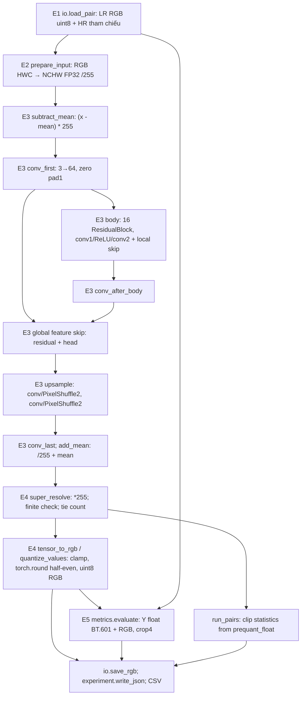

# EDSR-baseline ×4: cấu hình và kết quả

<!-- LOCKED_CONFIG_BEGIN -->
## Cấu hình đã khóa

EDSR-baseline ×4: 16 residual block, 64 kênh, res_scale=1, không BatchNorm;
không dùng EDSR full, self-ensemble hoặc chop. Checkpoint BasicSR:
`data/checkpoints/edsr/EDSR_Mx4_f64b16_DIV2K_official-0c287733.pth`.
SHA-256 tự tính:
`0c287733e70d1b8b8fc5885613ecbe451e5f3010bcae0307612ef5e4aa08dd5f`.
Wrapper `params`, 74 tensor FP32, 1,517,571 tham số; CPU restricted loading
`weights_only=True`, `map_location='cpu'`, `strict=True`, `eval()`.

Nguồn kiến trúc/mapping:
[BasicSR edsr_arch.py](https://github.com/XPixelGroup/BasicSR/blob/8d56e3a045f9fb3e1d8872f92ee4a4f07f886b0a/basicsr/archs/edsr_arch.py),
[convert_edsr](https://github.com/XPixelGroup/BasicSR/blob/8d56e3a045f9fb3e1d8872f92ee4a4f07f886b0a/scripts/model_conversion/convert_models.py),
[EDSR-PyTorch gốc](https://github.com/sanghyun-son/EDSR-PyTorch/blob/8dba5581a7502b92de9641eb431130d6c8ca5d7f/src/model/edsr.py).
Xem [MODELS_PROVENANCE.md](MODELS_PROVENANCE.md) về archive, hash và license.

### Mapping key và kiến trúc

| Bản gốc EDSR-PyTorch | BasicSR / implementation | Cấu hình |
|---|---|---|
| sub_mean | subtract_mean, không state key | RGB mean(.4488,.4371,.4040), img_range255 |
| head.0 | conv_first | 3→64, kernel3×3, zero pad1 |
| body.i.body.0/2, i=0…15 | body.i.conv1/conv2 | 64→64 kernel3×3 pad1, ReLU giữa, skip đơn vị |
| body.16 | conv_after_body | 64→64 kernel3×3 pad1 + global skip từ head |
| tail.0.0/2 | upsample.0/2 | Mỗi conv64→256 kernel3×3 pad1 + PixelShuffle2, không activation |
| tail.1 | conv_last | 64→3 kernel3×3 pad1 |
| add_mean | add_mean, không state key | /255 + RGB mean |

### Pipeline E1–E5

| Bước | Hàm và quy ước |
|---|---|
| E1 | io.load_pair đọc 5 cặp SelfExSR RGB uint8, HR=4×LR; không crop/resize sửa cặp |
| E2 | edsr.prepare_input: HWC RGB uint8 → NCHW FP32 /255, không BGR |
| E3 | Edsr.forward: (x−mean)×255, head/body/skip/PixelShuffle/tail, /255+mean; CPU, FP32, batch1, eval/inference_mode |
| E4 | Output×255, kiểm hữu hạn trước lượng tử, clamp[0,255], torch.round half-to-even, uint8 RGB; giữ float chưa clip và đếm tie .5 |
| E5 | Nguyên metrics.evaluate M1: RGB uint8→Y float BT.601, crop4 mỗi cạnh, range255; SSIM Gaussian11×11 σ1.5, K1=.01/K2=.03, population covariance; RGB bổ sung |

Mean Set5 là trung bình cộng per-image, không tính PSNR từ MSE gộp.
Đếm tie .5 trên FP32 output×255 trước clamp: số pixel có ít nhất một kênh
tie và số giá trị kênh tie được báo riêng. Tỷ lệ clip dưới0/trên255 tính
theo giá trị kênh; thêm tỷ lệ pixel có bất kỳ kênh bị clip để tránh nhập nhằng.

### Khác biệt KE1–KE5

| Mã | Khác biệt / hạn chế |
|---|---|
| KE1 | Nguồn mô hình mô tả DIV2K bicubic huấn luyện bằng MATLAB; LR đánh giá SelfExSR có công cụ tạo chưa xác định, không tự khẳng định degradation giống training |
| KE2 | Checkpoint chuyển đổi BasicSR chưa so tensor với edsr_baseline_x4-6b446fab.pt gốc; HEAD SNU một lần bị WinError10054, không GET; UNVERIFIED |
| KE3 | Half-to-even theo nguồn khác half-up của Bicubic/SRCNN; báo số tie .5, không đổi quy tắc để tăng điểm |
| KE4 | Metric gốc calc_psnr có quy ước Y riêng; project dùng nguyên protocol M1 cho cả Y và RGB |
| KE5 | Chưa có hash/near-duplicate audit DIV2K với Set5; trùng training chưa xác định |

### Quyết định E-D1…E-D5

E-D1: half-to-even sau clamp. E-D2: RGB[0,1] và mean shift BasicSR.
E-D3: không self-ensemble/chop. E-D4: SNU chỉ HEAD, không tự tải.
E-D5: giữ nguyên ngưỡng E-T2, không chọn checkpoint/preprocessing theo score.

### Ngưỡng và kết quả giai đoạn 1

| Test | Ngưỡng đã khóa | Kết quả thực tế |
|---|---|---|
| E-T1 | Hash, params, 74 key, 1,517,571 tham số, strict load phải khớp tuyệt đối | PASS |
| E-T2 | Float max≤1e-2 thang0–255; uint8 max≤1 mức, ≤.1% pixel khác; kiểm từng kênh; ≥6 mẫu gồm2crop Set14 | PASS7mẫu, tất cả uint8 khác0/1872pixel; float lớn nhất .0004192614720466281 |
| E-T3 | PixelShuffle đúng công thức out[c,h*r+i,w*r+j]=in[c*r²+i*r+j,h,w]; sai thứ tự phải khác | PASS cả positive/negative control |
| E-T4 | MeanShift BasicSR vs identity1×1 gốc và chiều ngược ≤1e-4 FP32 | PASS max1.52587890625e-5 cả hai chiều |
| E-T5 | Odd/non-square RGBuint8×4, hữu hạn trước lượng tử; chặn NaN/±Inf | PASS input7×11→28×44×3 và các test chặn lỗi |
| E-T5b | [.5,1.5,2.5,3.5,254.5,-.5,255.5,300,.49]→[0,2,2,4,254,0,255,255,0] tuyệt đối | PASS |
| E-T6a | E2/E4 giữ đúng thứ tự RGB riêng từng kênh | PASS |
| E-T6b | Mean tính tay từng kênh/chiều ngược ≤1e-4 | PASS7.62939453125e-6 /9.5367431640625e-7 |
| E-T6c | Reference NumPy độc lập trên màu ba kênh khác nhau, đạt E-T2 từng kênh | PASS |
| E-T6d | Đảo RGB/BGR phải vượt E-T2, nếu không vượt thì dừng | PASS: negative max205.18404301045433 >.01 |
| E-T7 | Chỉ ghi trạng thái HEAD SNU; không GET | UNVERIFIED, WinError10054 |
| E-T8 | Pytest/crosscheck trước và sau; hash5ảnh SRCNN không đổi | PASS65trước/75sau; crosscheck5/5 cả hai, mean28.43175155/.81126246;5hashSRCNN giữ nguyên |
| E-T9 bắt buộc | Output hợp lệ, hai lần cùng process bằng nhau, raw pixel hash+shape+dtype bằng process mới; known shift(+3,-2)/(0,0) đúng; synthetic pipeline lag0±1 | PASS synthetic/zebra/monarch |
| E-T9 chẩn đoán | Cảnh báo nếu Pearson<.95, lagHR ngoài0±1; kiểm trực quan bàn cờ/BGR/hình học | Không cảnh báo số; trực quan full/crop3mẫu PASS, không thấy bất thường |

Reference NumPy chỉ import numpy/pathlib, nhận trọng số từ NPZ tạm do
restricted torch.load xuất trong test, tự viết zero-padding conv/ReLU,
residual và PixelShuffle. Các test màu hằng không dùng correlation làm
tiêu chí. Bảng sai khác float max/mean (tất cả uint8 max0, 0% pixel khác):

| Mẫu | Float max | Float mean |
|---|---|---|
| noise | .0002061976457525816 | .00003262743303092102 |
| gradient | .000060718845446672276 | .000009436913230054624 |
| checker_color | .0004192614720466281 | .00008450510884298914 |
| distinct_rgb | .00006689217761390864 | .0000091583497916887 |
| constant_color | .00006346724711647767 | .000010493174084472058 |
| zebra crop | .0000460693055970296 | .000008268906888266389 |
| monarch crop | .00004968204041233548 | .0000069234138445063905 |

T9 Pearson so Y Bicubic: synthetic .98718139414718, zebra
.9665368979083441, monarch .969404309500438; tất cả lag(0,0).
T9 tie .5: synthetic0, zebra7, monarch14 pixel; cùng số giá trị kênh.
PSNR Set14 chỉ ghi nhận, không dùng chọn checkpoint/ngưỡng.
Các report/ảnh sanity nằm cục bộ `logs/m5_t9/`, không có trong Git.

### Timing và kiểm tra sau chạy đã khóa

CPU, FP32, batch1, 4 intra-op/1 inter-op đặt một lần đầu tiến trình;
3 warm-up +10 mẫu cho mỗi ảnh/phạm vi. Chính: super_resolve toàn E2–E4,
bao gồm kiểm hữu hạn, lượng tử và đếm tie của adapter; phụ: model(tensor)
E3 bên trong inference_mode với tensor prepare_input chuẩn bị sẵn.
Không tính I/O, nạp checkpoint hoặc metric. Giữ mọi mẫu, median/IQR(ms)
bằng nguyên timing.measure M1. Một forward riêng sinh output để tính metric,
không phải mẫu đo. Không chạy lại timing Bicubic hoặc SRCNN.

Sau run, chỉ đọc SR để tính lại metric và hash ảnh SRCNN. Đối chiếu độc
lập NumPy trên **toàn bộ LR img_002**, không gọi lại PyTorch EDSR trên Set5.
Chọn toàn ảnh vì receptive field của37conv khiến crop24×24 không còn vùng
trung tâm chắc chắn tránh ảnh hưởng zero padding. Cả reference và ảnh SR
đã lưu dùng cùng biên ảnh gốc, nên không nhập nhằng halo/crop; uint8 so
theo ngưỡng E-T2 đã khóa, báo cả số pixel/kênh khác và max sai khác.
<!-- LOCKED_CONFIG_END -->

## Receipt và kết quả lần chạy

Khối khóa được ghi trước lần suy luận Set5 đầu tiên. Receipt cục bộ
`logs/m5_lock.log`: **2026-11-09T03:41:18.129671+00:00**.
`METRICS_RUN_START`: **2026-11-09T03:41:32.545631+00:00**.
Các hash được kiểm trước run và sau khi hoàn thiện tài liệu; chỉ bổ sung
nội dung ngoài marker, không sửa source đã khóa.

| Thành phần khóa | SHA-256 |
|---|---|
| edsr.py | `92a48e13ef301b9faffd7935c0fead24e805ef358cb45303c6ad05eed7d7e77e` |
| run_edsr.py | `9cca44086f9c6fb4f235f36362e2c6227cc67d37a9cd6823317a5503d0d73887` |
| UTF-8 giữa hai marker cấu hình | `b74faccbe8dc840c778650bb9e519701db4809c00156a78a3ee0c3dc4de7f3e4` |

Run Set5 PyTorch duy nhất: `set5_edsr_baseline_x4_20261109_034132`.
Không chạy lại để cải thiện số hoặc thay mẫu timing. Log/receipt/helper
và run artifact là dữ liệu cục bộ, không công bố trong repository.

## Lưu đồ L5 khớp code

HR chỉ dùng để kiểm kích thước và tính metric, không đi vào mạng. Timing
chính bao quanh `super_resolve` E2–E4; timing phụ bao quanh `model(tensor)`
E3 với tensor chuẩn bị trước bằng `prepare_input`.

## Ghi nhận kiểm thử và giới hạn diễn giải

Test script trên dữ liệu tổng hợp được viết trước implementation: lần RED
dự kiến báo FileNotFoundError khi chưa có run_edsr.py, sau đó PASS. Lịch sử
RED được giữ cục bộ; không đổi ngưỡng để sửa test thất bại. Giai đoạn 1 có
các RED tương tự khi module/script chưa tồn tại, sau đó E-T1…E-T6/E-T9
đều đạt; E-T7 vẫn UNVERIFIED, không biến thành kiểm chứng tensor gốc.

Source EDSR gốc mặc định dữ liệu DIV2K và loss `1*L1` trong
[option.py](https://github.com/sanghyun-son/EDSR-PyTorch/blob/8dba5581a7502b92de9641eb431130d6c8ca5d7f/src/option.py).
Kiến trúc sâu hơn SRCNN, residual learning qua skip cục bộ/toàn cục, không
BN và xử lý chủ yếu ở LR trước PixelShuffle là căn cứ lý thuyết để giải
thích khả năng mô hình hóa biên/kết cấu. Không BN tránh chuẩn hóa lại biên
độ đặc trưng; residual learning hỗ trợ tối ưu mạng sâu. L1 tối ưu sai số
tái tạo nhưng không bảo đảm mọi ảnh có PSNR/SSIM cao hơn. Cấu hình nguồn
không thay thế log huấn luyện cụ thể của binary; lợi ích của từng yếu tố
chưa được tách bằng ablation trong project này.

## Nguồn tham khảo và hạn chế

Số tác giả công bố cho EDSR-baseline Set5×4: **chưa trích được**.
[PDF EDSR tại CVF](https://openaccess.thecvf.com/content_cvpr_2017_workshops/w12/papers/Lim_Enhanced_Deep_Residual_CVPR_2017_paper.pdf)
bị công cụ đọc trả HTTP403 trong lần truy cập này; không điền điểm theo
trí nhớ hoặc nhầm số của EDSR full/EDSR+ với baseline. Số bài báo chỉ có
thể tham khảo nếu đọc được bảng và đúng biến thể, không là tiêu chí pass/fail.

KE1–KE5 vẫn áp dụng. License code BasicSR Apache-2.0 không xác nhận
license riêng của trọng số chuyển đổi; chưa xác định điều khoản trọng số
và trùng dữ liệu DIV2K/Set5. Không có đối chiếu trực tiếp tensor gốc SNU
hoặc oracle MATLAB; không tuyên bố toàn bộ pipeline gốc được tái tạo chính xác.

## Kết quả Set5 từ lần chạy duy nhất

Run_id: `set5_edsr_baseline_x4_20261109_034132`. UTC bắt đầu `2026-11-09T03:41:32.545631+00:00`. Các bảng sinh trực tiếp từ `results/set5_edsr_baseline_x4_20261109_034132/metrics.json`, kiểm với CSV và PNG đã lưu; artifact không có trong Git.

| Ảnh | PSNR Y (dB) | SSIM Y | PSNR RGB (dB) | SSIM RGB |
|---|---|---|---|---|
| img_001_SRF_4 | 33.74126534 | 0.89305571 | 32.23696714 | 0.86810922 |
| img_002_SRF_4 | 34.93734816 | 0.94440687 | 32.72898205 | 0.92521787 |
| img_003_SRF_4 | 28.43713628 | 0.92238277 | 26.99854316 | 0.90220075 |
| img_004_SRF_4 | 32.93887726 | 0.79633946 | 29.91237493 | 0.71893176 |
| img_005_SRF_4 | 30.43501687 | 0.91289760 | 29.04308954 | 0.90096851 |
| Mean per-image | 32.09792878 | 0.89381648 | 30.18399136 | 0.86308562 |

### EDSR so với Bicubic

| Ảnh | Bicubic PSNR Y | ΔPSNR Y EDSR−Bicubic (dB) | Bicubic SSIM Y | ΔSSIM Y |
|---|---|---|---|---|
| img_001_SRF_4 | 31.78644620 | +1.95481914 | 0.85765643 | +0.03539929 |
| img_002_SRF_4 | 30.18703920 | +4.75030896 | 0.87380864 | +0.07059822 |
| img_003_SRF_4 | 22.10101285 | +6.33612343 | 0.73748384 | +0.18489893 |
| img_004_SRF_4 | 31.61503165 | +1.32384561 | 0.75466398 | +0.04167548 |
| img_005_SRF_4 | 26.46922783 | +3.96578904 | 0.83269942 | +0.08019818 |
| Mean per-image | 28.43175155 | +3.66617724 | 0.81126246 | +0.08255402 |

### EDSR so với SRCNN

| Ảnh | SRCNN PSNR Y | ΔPSNR Y EDSR−SRCNN (dB) | SRCNN SSIM Y | ΔSSIM Y |
|---|---|---|---|---|
| img_001_SRF_4 | 33.10591833 | +0.63534701 | 0.88198473 | +0.01107099 |
| img_002_SRF_4 | 32.52308254 | +2.41426562 | 0.91108920 | +0.03331766 |
| img_003_SRF_4 | 25.45199801 | +2.98513827 | 0.85636052 | +0.06602225 |
| img_004_SRF_4 | 32.44167277 | +0.49720448 | 0.78009704 | +0.01624242 |
| img_005_SRF_4 | 28.88051999 | +1.55449688 | 0.88327313 | +0.02962447 |
| Mean per-image | 30.48063833 | +1.61729045 | 0.86256093 | +0.03125556 |

### Timing CPU, median/IQR (ms)

| Ảnh | EDSR E2–E4 | EDSR E3 | Bicubic M1 | SRCNN P2–P8 | SRCNN P5 |
|---|---|---|---|---|---|
| img_001_SRF_4 | 486.812350 / 304.964000 | 769.861950 / 36.817175 | 66.837000 / 40.524875 | 421.809350 / 38.730375 | 312.902700 / 41.288650 |
| img_002_SRF_4 | 278.613000 / 34.322625 | 248.390100 / 22.344150 | 15.689000 / 0.956925 | 129.934400 / 6.793050 | 117.318850 / 6.141250 |
| img_003_SRF_4 | 214.447900 / 34.402700 | 210.287750 / 25.375075 | 12.283550 / 3.043850 | 121.582750 / 16.175375 | 85.115400 / 8.809525 |
| img_004_SRF_4 | 253.869400 / 29.696575 | 233.367050 / 18.735875 | 18.047200 / 6.947300 | 138.799350 / 14.344500 | 91.817400 / 5.460725 |
| img_005_SRF_4 | 281.190450 / 51.739475 | 247.883000 / 20.051375 | 15.538200 / 2.734225 | 138.253900 / 26.539425 | 103.704450 / 17.477925 |

EDSR và SRCNN: **3 warm-up + 10 mẫu** cho từng phạm vi/mỗi ảnh. Bicubic M1: **3 warm-up + 30 mẫu**. Mọi mẫu EDSR được giữ trong JSON. Bicubic/SRCNN lấy nguyên artifact đã nghiệm thu, không chạy lại. Khác thời điểm, backend, thread và số mẫu giới hạn so sánh; không suy ra speedup phổ quát.

Riêng img_001, median forward-only lớn hơn median pipeline và IQR pipeline lớn. Hai phạm vi được đo ở hai chuỗi riêng; đây không phải phân rã cộng chi phí. Biến động lịch CPU/tần số/cache là các giả thuyết, chưa đo nguyên nhân; không bỏ mẫu hoặc chạy lại để làm số đẹp hơn.

### Tie .5 và clip trước lượng tử

| Ảnh | Pixel tie bất kỳ kênh | Giá trị kênh tie | Kênh <0 (%) | Kênh >255 (%) | Pixel có kênh clip (%) |
|---|---|---|---|---|---|
| img_001_SRF_4 | 8 | 8 | 0.0448862712 | 0.0150044759 | 0.1487731934 |
| img_002_SRF_4 | 2 | 2 | 0.2033500514 | 0.0112525720 | 0.6172839506 |
| img_003_SRF_4 | 3 | 3 | 0.0000000000 | 0.0361124674 | 0.0915527344 |
| img_004_SRF_4 | 0 | 0 | 0.0012755102 | 0.0029761905 | 0.0127551020 |
| img_005_SRF_4 | 3 | 3 | 0.0072249422 | 0.0016999864 | 0.0267747858 |

Tie được đếm chính xác trên FP32 trước clamp. Số pixel và số giá trị kênh có thể khác nhau; tỷ lệ clip kênh dùng mẫu số H×W×3, tỷ lệ pixel dùng H×W. Không áp dụng ngưỡng clip mới sau khi xem kết quả.

### Kiểm tra sau chạy

- Pytest required Set5: **76 passed**; crosscheck Bicubic **PASS 5/5**, mean Y 28.43175155/.81126246. Năm SHA-256 file PNG SRCNN không đổi; không chạy lại SRCNN trên Set5.
- Tính lại MSE/PSNR/SSIM Y và RGB từ cả 5 PNG EDSR: max sai khác **0.0**, dung sai kiểm 1e-9. CSV/JSON/mean và median/IQR từ đủ 10 mẫu đều khớp.
- Reference NumPy float64 trên **toàn LR img_002 72×72**, output 288×288; không cắt input nên zero padding đúng biên ảnh gốc, không cần giả định halo. So với PNG SR: **3/82,944 pixel** khác (**0.003616898148148148%**), max **1 mức**, 3 giá trị kênh khác (R=0/G=2/B=1), đạt E-T2 ≤1 mức/≤0.1%. Chỉ gọi NumPy reference, không chạy lại PyTorch EDSR trên Set5.

Reference dùng file NPZ tạm xuất từ restricted CPU torch.load; không instantiate model. Không có float PyTorch toàn ảnh lưu sẵn để so trước lượng tử sau run, nên phép kiểm này chỉ so uint8 với PNG; kiểm float trước lượng tử đã thực hiện trên 7 mẫu giai đoạn 1.

CPU `11th Gen Intel(R) Core(TM) i7-1185G7 @ 3.00GHz`; RAM 16889188352 byte; OS `Windows-10-10.0.19045-SP0`; Python 3.12.10; torch 2.10.0+cpu; FP32/batch 1, CPU threads 4/1. OMP/MKL/OPENBLAS thread env không đặt. Môi trường và receipt đầy đủ lưu trong environment.json.

## Nhận xét từng ảnh

- **img_001_SRF_4**: quan sát định lượng ΔPSNR Y so với SRCNN **+0.63534701 dB**, ΔSSIM Y **+0.01107099**; so Bicubic ΔPSNR Y **+1.95481914 dB**. Ảnh em bé có da chuyển sắc trơn, biên mắt/miệng và kết cấu mũ len. Giả thuyết: biểu diễn sâu và skip đặc trưng bổ sung đáp ứng biên mà ba lớp SRCNN còn hạn chế, nhưng vùng da trơn có thể làm lợi ích tổng thể ít hơn các ảnh nhiều cạnh. Không dùng metric toàn ảnh để khẳng định từng sợi len khớp HR.
- **img_002_SRF_4**: quan sát định lượng ΔPSNR Y so với SRCNN **+2.41426562 dB**, ΔSSIM Y **+0.03331766**; so Bicubic ΔPSNR Y **+4.75030896 dB**. Ảnh chim có nhiều cạnh mỏ/thân và lá nền theo nhiều hướng. Giả thuyết: mạng sâu, không BN và dữ liệu DIV2K giúp mô hình hóa thêm các cạnh này; phép upscale cuối mạng bằng PixelShuffle học cách phân bố đặc trưng sang HR. Chưa tách được đóng góp của nền và chim, cũng chưa chứng minh L1 là nguyên nhân độc lập.
- **img_003_SRF_4**: quan sát định lượng ΔPSNR Y so với SRCNN **+2.98513827 dB**, ΔSSIM Y **+0.06602225**; so Bicubic ΔPSNR Y **+6.33612343 dB**. Ảnh cánh bướm chứa nhiều đường viền đen tương phản với mảng màu. Đây là mức tăng PSNR Y lớn nhất so với cả Bicubic và SRCNN trong năm ảnh. Giả thuyết: các residual block học hiệu chỉnh ở biên/kết cấu và PixelShuffle tái tạo vị trí HR tốt hơn trong trường hợp này. Điểm cao hơn không chứng minh mọi chấm/vân cánh phục hồi đúng; chưa có ablation từng khối.
- **img_004_SRF_4**: quan sát định lượng ΔPSNR Y so với SRCNN **+0.49720448 dB**, ΔSSIM Y **+0.01624242**; so Bicubic ΔPSNR Y **+1.32384561 dB**. Ảnh gương mặt nghiêng có nhiều vùng da trơn xen tóc và đường viền mặt. Đây là mức tăng PSNR Y nhỏ nhất so với SRCNN trong năm ảnh. Giả thuyết: SRCNN đã xử lý được một phần chuyển sắc và biên đơn giản, nên dung lượng EDSR tăng không mang lợi ích đồng đều toàn ảnh. Chưa tính metric từng vùng hoặc xác minh giả thuyết từ gradient/texture.
- **img_005_SRF_4**: quan sát định lượng ΔPSNR Y so với SRCNN **+1.55449688 dB**, ΔSSIM Y **+0.02962447**; so Bicubic ΔPSNR Y **+3.96578904 dB**. Ảnh chân dung có cạnh mắt/lông mày, ngón tay và họa tiết mũ. Giả thuyết: mạng sâu với skip đặc trưng, không BN và huấn luyện tái tạo L1 có thể hỗ trợ các chi tiết này so với SRCNN nông. Không đồng nhất tăng PSNR/SSIM với việc họa tiết mới là chi tiết gốc; màu sắc và sai khác degradation vẫn chịu KE1–KE5.

Năm ảnh là tập nhỏ. Mọi giải thích cơ chế ở trên là giả thuyết dựa trên kiến trúc và nội dung ảnh, không phải kết luận nhân quả đã kiểm ablation. Không chọn biến thể/checkpoint từ mức tăng quan sát được. Timing và ảnh không chứng minh khả năng tổng quát hóa hoặc quyền phân phối trọng số.
