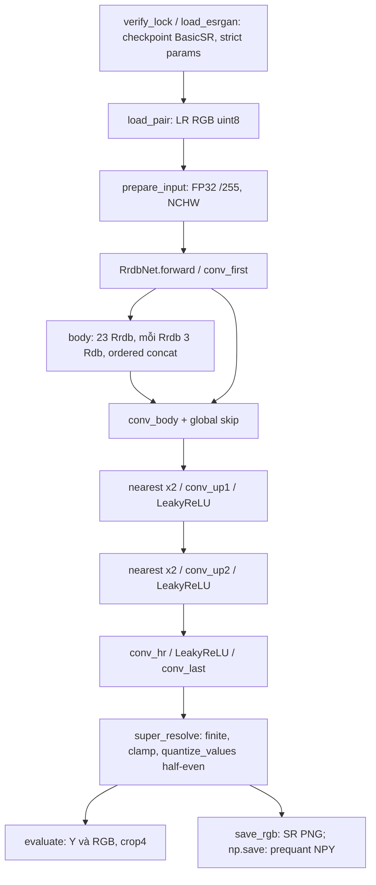

# Original ESRGAN ×4 — cấu hình và kết quả Set5

<!-- LOCKED_CONFIG_BEGIN -->
## Cấu hình khóa trước lần chạy Set5

Kiến trúc Original ESRGAN; checkpoint là bản BasicSR chuyển đổi; chuỗi chuyển đổi từ trọng số gốc của tác giả **UNVERIFIED**; license trọng số và sự trùng lặp dữ liệu huấn luyện với Set5 **UNVERIFIED**. Khớp kiến trúc không chứng minh đã xác minh trọng số gốc tác giả.

Nhãn giữ trong output: `Original ESRGAN architecture; BasicSR converted checkpoint; conversion chain from original author weights UNVERIFIED; weight license and training overlap with Set5 UNVERIFIED.`

Checkpoint tại chỗ: `data/checkpoints/esrgan/ESRGAN_SRx4_DF2KOST_official-ff704c30.pth`.
SHA-256 tự tính, không phải checksum tác giả công bố:
`ff704c30ff560305e48ed1f4db895e525ab6bc81a46fafe80c0094a271c806d9`.
702 tensor float32, 16.697.987 tham số, wrapper `params`, nạp `weights_only=True,map_location='cpu'`, `strict=True`, `eval()`.

### Kiến trúc và pipeline

23 RRDB ×3 RDB; mỗi RDB có conv 3×3 lần lượt 64→32, 96→32, 128→32, 160→32, 192→64. Dense concat theo đúng `[x,x1,x2,…]`, x gốc đứng trước. LeakyReLU slope0.2 sau conv1–4, không activation sau conv5. RDB(x)=x+0.2·conv5; RRDB(x)=x+0.2·RDB3(RDB2(RDB1(x))). Conv zero padding1. Conv_first →23 RRDB→conv_body + global skip →2×(nearest ×2→conv→LeakyReLU)→conv_hr→LeakyReLU→conv_last. Không BN, mean shift, pixel shuffle, deconv, self-ensemble hay chop.

G1 `load_pair` đọc đúng5 cặp LR–HR SelfExSR, không chỉnh kích thước tham chiếu.
G2 `prepare_input`: RGB uint8 HWC→CPU FP32 NCHW /255, batch1, không trừ mean và không đổi BGR.
G3 `RrdbNet.forward`: mạng trên LR.
G4 `super_resolve`: kiểm NaN/Inf trước clamp; clamp[0,1]→×255→`torch.round` half-to-even→RGB uint8. Đồng thời lưu prequant float RGB thang0–255 chưa clamp để kiểm chứng.
G5 `metrics.evaluate` nguyên M1: Y float BT.601 và RGB; HR/SR phải cùng shape, crop4 mỗi cạnh, range255. Y=`16+(65.481R+128.553G+24.966B)/255`. SSIM Gaussian11×11 σ1.5, K1=.01,K2=.03,population covariance. Trung bình là trung bình cộng per-image, không PSNR của MSE gộp.

### Quyết định đã khóa

| Mã | Quyết định |
|---|---|
| G-D1 | Chỉ checkpoint GAN đã nêu; không Real-ESRGAN hoặc RRDB_PSNR, chọn trước mọi PSNR |
| G-D2 | RGB [0,1], không mean shift, không bicubic trước mạng |
| G-D3 | Half-to-even theo script gốc/BasicSR tensor2img; không dùng tensor2img_fast truncate |
| G-D4 | Zero padding, scale0.2 cả RDB/RRDB; nearest×2 hai lần; không ensemble/chop/tile |
| G-D5 | CPU FP32 batch1, thread4/1, warm-up3 và repeats10; không bỏ mẫu hoặc đổi số lần đo |
| G-D6 | Giữ ngưỡng G-T2 maxfloat≤0.02, meanfloat≤0.002 trên0–255; uint8max≤1, tỷ lệ pixel khác bất kỳ kênh≤0.5%, không nới |

### Kiểm chứng trước chạy Set5

| Mã | Kết quả và điều kiện |
|---|---|
| G-T1 | PASS hash/schema/dtype/strict load; 702 tensor/16.697.987 scalar |
| G-T2 | PASS6 mẫu đầy đủ pixel/kênh: noise6×7,gradient7×9,checker6×8,constant8×9,zebra/monarch6×7; maxfloat quan sát0.0011471071603565974, mean lớn nhất0.00022073873414237067; maxuint8=1, khác tối đa0.13020833333333331% pixel; reference NumPy float64 không torch/model |
| G-T3 | PASS concat thứ tự và kernel bất đối xứng/kênh |
| G-T4 | PASS RDB/RRDB scale riêng, leaky/conv5; tính tay actual network signed routing/global skip/linear first-body-last |
| G-T5 | PASS hình học/zero biên/two nearest-conv-leaky/conv_hr-leaky, shapes1×1/1×5/5×1/5×7; max lỗi manual2.980232227667301e-9<1e-6; half-even ties/clamp |
| G-T6 | PASS đủ8negative: RGB/BGR,concat,RDB scale1/0.1,RRDB scale1/0.1,sai x+.2(out−x),bilinear; mỗi lỗi vượt ít nhất1ngưỡng G-T2 |
| G-T7 | PASS input/finite/file/no overwrite/JSON null/reference independence; logs và NPZ trong project |
| G-T8 | PASS117 tests, crosscheck Bicubic5/5, hash15 SR SRCNN/FSRCNN/EDSR không đổi; không đo lại baseline |
| G-T9 | Required checks PASS cả3 ảnh, repeat cùng/khác tiến trình bằng raw pixels SHA256+shape+dtype, known shifts đúng; visual review zebra/monarch đạt, không lệch hay checkerboard. **WARNING_RECORDED**, không chuyển thành PASS của Pearson: synthetic0.9130020002417197 và zebra0.9431419469002692 dưới0.95; monarch0.9639999819471159. Mọi lag(0,0). Cảnh báo gốc được giữ; Gaussian σ1/2/4 và vùng HR Y>20 chỉ chẩn đoán, không thêm ngưỡng |

### Timing và giới hạn đã khóa

`torch.set_num_threads(4)`/`set_num_interop_threads(1)` một lần đầu tiến trình; `eval` + `inference_mode`; batch1, FP32, CPU. `timing.measure` dùng `perf_counter_ns`, warm-up3/repeats10. Chính là toàn `super_resolve` (G2–G4), phụ chỉ `model(tensor)` G3, tensor chuẩn bị trước. Không gồm load checkpoint/I/O/metric, giữ đủ raw samples, median/IQR/n. CPU/RAM/OS/Python/torch/thread/env và22pin pip freeze trong receipt và environment. Receipt khóa source runner/mạng cùng module import trực tiếp và phụ thuộc project, config và checkpoint trước `METRICS_RUN_START`. Sau khóa không sửa source đã hash.

Kiểm chứng sau chạy: metric độc lập từ5PNG bằng NumPy/Pillow/SciPy, không import sr_compare. Reference NumPy **toàn img_003 LR64×64, không crop**, giới hạn6giờ; so floatprequant đã lưu và uint8 từng kênh, chỉ đối chiếu số học, không chạy lại benchmark hoặc ghi results.
<!-- LOCKED_CONFIG_END -->

## Kết quả Set5

Run `set5_esrgan_x4_20261109_060235`; đường dẫn `results/set5_esrgan_x4_20261109_060235/`. Đúng một lần chạy, đủ 5 ảnh; raw samples không bị loại. Mỗi ảnh có SR PNG và prequant float32 NPY chưa clamp; metrics JSON/CSV và environment JSON. Ảnh/NPY/run artifacts không commit.

Khóa UTC `2026-11-09T06:02:20.905872+00:00`; `METRICS_RUN_START` UTC `2026-11-09T06:02:36.554598+00:00`, sau khóa và khớp environment. Receipt `logs/m6_lock.log` là log cục bộ, không công bố trong repository. SHA-256 khối khóa `d2a3137c280e74fcbf1f562d9da58789169eea1c86a3b7b4aa9be06ff5955d5a`.

| Source khóa | SHA-256 |
| --- | --- |
| scripts/run_esrgan.py | 5fe2c57c664f29d5349f34b32f1b080c16c70faf8190388f5caea8c5550ea612 |
| src/sr_compare/esrgan.py | 8970ca3cdd3c798c59e80f4b5b07367385f3f18ce10453dab352964d18fcebfc |
| src/sr_compare/experiment.py | 50f7cd6548c2e01c5acdf583c01348ba9bf99360b2f6a96165b763ead6ded130 |
| src/sr_compare/io.py | c468b61f3dc2cfc4bbf8e3da8010b6604971aff487796d7a1b40b264aaabd48c |
| src/sr_compare/metrics.py | 4d29b4eac0928890532eb2516177ec2f967278e03c6e5727625e20ab8b44b837 |
| src/sr_compare/timing.py | 24bb99f1902fb3e18ec753d3f85e4c908f9c323aa2126a1e30d5236e230a9058 |
| src/sr_compare/bicubic.py | cf5d6d3cd4d75e66b8022472fe37bae18ee23de262fafd72b66a071aabbca94a |
| src/sr_compare/degradation.py | 0f78a6e9f87e0ac1769fba9c70cda3043845c0bfbfce1a3cd3574fceb5204fb3 |
| src/sr_compare/__init__.py | 89b18a7554f18a7de4fe5cf76609e8259dd6acbb2b8fab725bf62b4dc668235d |

CPU 11th Gen Intel(R) Core(TM) i7-1185G7 @ 3.00GHz; RAM 16889188352 byte; OS Windows-10-10.0.19045-SP0; Python 3.12.10; torch 2.10.0+cpu; thread 4/1; OMP/MKL/OPENBLAS chưa đặt. Receipt và environment lưu đủ 22 pins:

| Package | Pin |
| --- | --- |
| Jinja2 | 3.1.6 |
| MarkupSafe | 3.0.2 |
| colorama | 0.4.6 |
| filelock | 3.18.0 |
| fsspec | 2025.5.1 |
| imageio | 2.37.0 |
| iniconfig | 2.1.0 |
| lazy_loader | 0.4 |
| mpmath | 1.3.0 |
| networkx | 3.4.2 |
| numpy | 2.2.6 |
| packaging | 25.0 |
| pillow | 11.2.1 |
| pluggy | 1.5.0 |
| pytest | 8.3.5 |
| scikit-image | 0.25.2 |
| scipy | 1.15.3 |
| setuptools | 80.9.0 |
| sympy | 1.14.0 |
| tifffile | 2025.5.10 |
| torch | 2.10.0+cpu |
| typing_extensions | 4.13.2 |

| Ảnh | MSE Y | PSNR Y | SSIM Y | MSE RGB | PSNR RGB | SSIM RGB |
| --- | --- | --- | --- | --- | --- | --- |
| img_001_SRF_4 | 45.97844420 | 31.50526089 | 0.84419798 | 65.61469619 | 29.96079239 | 0.80990592 |
| img_002_SRF_4 | 28.52306791 | 33.57884125 | 0.92469104 | 52.17956207 | 30.95579931 | 0.88702790 |
| img_003_SRF_4 | 118.09286470 | 27.40856703 | 0.90145373 | 168.56700919 | 25.86307779 | 0.87272617 |
| img_004_SRF_4 | 63.00141248 | 30.13730074 | 0.69240657 | 110.72293108 | 27.68842787 | 0.62427240 |
| img_005_SRF_4 | 69.01754768 | 29.74120837 | 0.89625377 | 97.33278319 | 28.24821219 | 0.87866780 |
| Trung bình | 64.92266739 | 30.47423566 | 0.85180062 | 98.88339635 | 28.54326191 | 0.81452004 |

### Clip và exact ties trước lượng tử

Tỷ lệ <0/>255 tính theo từng giá trị kênh RGB float chưa clamp. Cột pixel là có bất kỳ kênh nằm ngoài khoảng. Ties đếm trên prequant 0–255 chưa clamp, trước half-to-even; không phải số ảnh hưởng cảm nhận đã đo.

| Ảnh | <0 (%) | >255 (%) | Pixel clip (%) | Pixel có tie | Giá trị kênh tie |
| --- | --- | --- | --- | --- | --- |
| img_001_SRF_4 | 0.26143392 | 0.68016052 | 1.75247192 | 10 | 10 |
| img_002_SRF_4 | 1.72405478 | 0.10529192 | 5.46151620 | 2 | 2 |
| img_003_SRF_4 | 0.00915527 | 0.13580322 | 0.34484863 | 0 | 0 |
| img_004_SRF_4 | 0.16284014 | 0.04634354 | 0.53443878 | 2 | 2 |
| img_005_SRF_4 | 0.08499932 | 0.00254998 | 0.23587311 | 0 | 0 |

### So sánh từng ảnh với bốn baseline

Thứ hạng PSNR Y trung bình (hiển thị hai chữ số thập phân) là **EDSR 32,10 > FSRCNN 30,70 > SRCNN 30,48 > ESRGAN 30,47 > Bicubic 28,43**. ESRGAN gần ngang SRCNN, thấp hơn FSRCNN và EDSR; không dùng cảm giác sắc nét để đảo thứ hạng độ chính xác tái tạo. Trung bình vẫn lấy từ số đầy đủ trong từng run, không tính từ các số đã làm tròn này. ESRGAN kém Bicubic ở img_001 về PSNR Y và ở img_004 về cả PSNR Y/SSIM Y; phân tích riêng từng ảnh và các khác biệt texture với HR nằm dưới đây.

Δ=ESRGAN−thuật toán tham chiếu. Run tham chiếu: `set5_numpy_x4_20261108_1627`, `set5_srcnn955_x4_20261108_201641`, `set5_fsrcnn56124_x4_20261109_043641`, `set5_edsr_baseline_x4_20261109_034132`. Không chạy lại các baseline.

| Ảnh | Tham chiếu | Δ PSNR Y (dB) | Δ SSIM Y |
| --- | --- | --- | --- |
| img_001_SRF_4 | Bicubic | -0.28118531 | -0.01345844 |
| img_001_SRF_4 | SRCNN | -1.60065744 | -0.03778675 |
| img_001_SRF_4 | FSRCNN | -1.69161452 | -0.03646628 |
| img_001_SRF_4 | EDSR | -2.23600445 | -0.04885773 |
| img_002_SRF_4 | Bicubic | 3.39180204 | 0.05088239 |
| img_002_SRF_4 | SRCNN | 1.05575871 | 0.01360183 |
| img_002_SRF_4 | FSRCNN | 0.79074285 | 0.01151213 |
| img_002_SRF_4 | EDSR | -1.35850692 | -0.01971583 |
| img_003_SRF_4 | Bicubic | 5.30755418 | 0.16396989 |
| img_003_SRF_4 | SRCNN | 1.95656902 | 0.04509321 |
| img_003_SRF_4 | FSRCNN | 1.75513836 | 0.03776920 |
| img_003_SRF_4 | EDSR | -1.02856925 | -0.02092904 |
| img_004_SRF_4 | Bicubic | -1.47773090 | -0.06225742 |
| img_004_SRF_4 | SRCNN | -2.30437203 | -0.08769047 |
| img_004_SRF_4 | FSRCNN | -2.38320243 | -0.08915591 |
| img_004_SRF_4 | EDSR | -2.80157651 | -0.10393289 |
| img_005_SRF_4 | Bicubic | 3.27198054 | 0.06355435 |
| img_005_SRF_4 | SRCNN | 0.86068838 | 0.01298064 |
| img_005_SRF_4 | FSRCNN | 0.39202717 | 0.00809923 |
| img_005_SRF_4 | EDSR | -0.69380850 | -0.01664383 |

### Timing CPU (ms), median/IQR

| Ảnh | Thuật toán | Median chính | IQR chính | n | Median mạng | IQR mạng | n mạng |
| --- | --- | --- | --- | --- | --- | --- | --- |
| img_001_SRF_4 | Bicubic | 66.83700000 | 40.52487500 | 30 | — | — | — |
| img_002_SRF_4 | Bicubic | 15.68900000 | 0.95692500 | 30 | — | — | — |
| img_003_SRF_4 | Bicubic | 12.28355000 | 3.04385000 | 30 | — | — | — |
| img_004_SRF_4 | Bicubic | 18.04720000 | 6.94730000 | 30 | — | — | — |
| img_005_SRF_4 | Bicubic | 15.53820000 | 2.73422500 | 30 | — | — | — |
| img_001_SRF_4 | SRCNN | 421.80935000 | 38.73037500 | 10 | 312.90270000 | 41.28865000 | 10 |
| img_002_SRF_4 | SRCNN | 129.93440000 | 6.79305000 | 10 | 117.31885000 | 6.14125000 | 10 |
| img_003_SRF_4 | SRCNN | 121.58275000 | 16.17537500 | 10 | 85.11540000 | 8.80952500 | 10 |
| img_004_SRF_4 | SRCNN | 138.79935000 | 14.34450000 | 10 | 91.81740000 | 5.46072500 | 10 |
| img_005_SRF_4 | SRCNN | 138.25390000 | 26.53942500 | 10 | 103.70445000 | 17.47792500 | 10 |
| img_001_SRF_4 | FSRCNN | 181.94275000 | 15.27577500 | 10 | 40.10815000 | 2.78607500 | 10 |
| img_002_SRF_4 | FSRCNN | 54.76600000 | 2.49637500 | 10 | 14.13315000 | 1.14895000 | 10 |
| img_003_SRF_4 | FSRCNN | 45.76910000 | 2.34145000 | 10 | 12.92890000 | 2.51760000 | 10 |
| img_004_SRF_4 | FSRCNN | 51.52540000 | 3.16857500 | 10 | 15.80720000 | 0.64532500 | 10 |
| img_005_SRF_4 | FSRCNN | 51.58340000 | 7.74315000 | 10 | 14.88525000 | 2.16980000 | 10 |
| img_001_SRF_4 | EDSR | 486.81235000 | 304.96400000 | 10 | 769.86195000 | 36.81717500 | 10 |
| img_002_SRF_4 | EDSR | 278.61300000 | 34.32262500 | 10 | 248.39010000 | 22.34415000 | 10 |
| img_003_SRF_4 | EDSR | 214.44790000 | 34.40270000 | 10 | 210.28775000 | 25.37507500 | 10 |
| img_004_SRF_4 | EDSR | 253.86940000 | 29.69657500 | 10 | 233.36705000 | 18.73587500 | 10 |
| img_005_SRF_4 | EDSR | 281.19045000 | 51.73947500 | 10 | 247.88300000 | 20.05137500 | 10 |
| img_001_SRF_4 | ESRGAN | 7457.74820000 | 451.17560000 | 10 | 4945.36560000 | 2177.87850000 | 10 |
| img_002_SRF_4 | ESRGAN | 2323.49825000 | 176.38827500 | 10 | 2297.49890000 | 143.39732500 | 10 |
| img_003_SRF_4 | ESRGAN | 1750.48905000 | 64.88435000 | 10 | 1872.96005000 | 114.09097500 | 10 |
| img_004_SRF_4 | ESRGAN | 2209.57655000 | 131.64437500 | 10 | 2193.03720000 | 175.30610000 | 10 |
| img_005_SRF_4 | ESRGAN | 2223.54880000 | 93.91462500 | 10 | 2300.46990000 | 235.10347500 | 10 |

Bicubic: 3 warm-up +30 lần đo; các mạng: 3 +10. Mỗi pipeline có công việc màu/resize/lượng tử khác nhau; cột mạng chỉ forward. Các phiên chạy cùng CPU nhưng khác thời điểm/tải nền/trạng thái nhiệt, không phải thiết kế kiểm định speedup; không suy ra tăng tốc phần cứng hay độ tin cậy thống kê từ một median. Giữ nguyên IQR lớn và bất thường forward EDSR img_001 lớn hơn pipeline từ hai loạt đo riêng; không chạy lại. Không trừ hai median để ước lượng chính xác overhead.

## Lưu đồ L6

## Kiểm chứng độc lập sau chạy

Đọc lại đủ5 SR PNG; chương trình riêng không import sr_compare, tự viết Y BT.601/crop4/MSE/PSNR và SSIM population Gaussian11×11 sigma1.5 bằng scipy.signal.convolve2d mode valid. RGB tính SSIM từng kênh rồi trung bình. Tất cả chỉ số Y/RGB khớp metrics.json với absolute tolerance1e-9; max sai khác toàn bộ MSE/PSNR/SSIM=2.9753977059954195e-14.

Reference NumPy float64 tests/reference_esrgan_numpy.py đọc NPZ tạm xuất từ safe checkpoint; không torch, không module model ứng dụng. Chạy **toàn img_003 LR64×64**, không crop, output256×256×3. So float trước lượng tử đã lưu: max |Δ|=0.00042653845284235103, mean=2.8997365900904184e-05 trên thang0–255. RGB uint8 khác 7/65536 pixel, 7/196608 giá trị kênh; max=1, mean |Δ|=3.5603841145833336e-05. Không exact pixel; không chỉnh cấu hình theo kết quả.

| Kênh | Float max | Float mean | Giá trị uint8 khác | Uint8 max | Uint8 mean |
| --- | --- | --- | --- | --- | --- |
| R | 0.00042654 | 0.00003374 | 5 | 1 | 0.00007629 |
| G | 0.00038495 | 0.00002671 | 0 | 0 | 0.00000000 |
| B | 0.00040706 | 0.00002654 | 2 | 1 | 0.00003052 |

Thời gian riêng reference=15.220078200 giây; wall gồm nạp weights và so=15.837231300 giây, trong ngân sách6giờ; có watchdog21600giây không fallback crop. Peak working set lifetime của tiến trình độc lập=738783232 byte (bao gồm weights/intermediates/so sánh). Đây là đo thời gian và RAM của **phép kiểm chứng**, không phải mẫu inference benchmark; không ghi vào results. Sai khác FP32–float64/rounding là giả thuyết số học, không chứng minh provenance checkpoint.

Regression sau chạy: `pytest -q --require-set5`: **119 passed (16.29s)**; crosscheck Bicubic **5/5 PASS**, trung bình Y 28.43175155 / 0.81126246. Hash 15 ảnh SR cũ được đối chiếu snapshot; không chạy lại benchmark baseline. Kiểm receipt/source và bảng số được thực hiện lại sau khi hoàn thiện tài liệu.

## Khác biệt với implementation nguồn

Nguồn [RRDBNet_arch.py](https://github.com/xinntao/ESRGAN/blob/73e9b634cf987f5996ac2dd33f4050922398a921/RRDBNet_arch.py#L14-L78) và [test.py](https://github.com/xinntao/ESRGAN/blob/73e9b634cf987f5996ac2dd33f4050922398a921/test.py#L27-L37): cv2 đọc BGR rồi đảo RGB, /255; output đổi BGR chỉ để ghi ảnh; clamp và NumPy round. Chương trình dùng Pillow RGB nên không đảo BGR lại, torch.round half-even cùng quy tắc ties, giữ RGB uint8 cho metric M1. Không dùng tensor2img_fast truncate.

KG1: SelfExSR LR có provenance degradation chưa xác minh; KG2: conversion chain original→BasicSR UNVERIFIED; KG3: FP32/platform/thứ tự cộng khác float64; KG4: metric chính Y M1 khác RGB config BasicSR; KG5: Pillow RGB I/O và lượng tử tường minh. Tên key đổi RRDB_trunk→body, RDB→rdb, trunk_conv→conv_body, upconv→conv_up, HRconv→conv_hr theo [convert_esrgan_model](https://github.com/XPixelGroup/BasicSR/blob/8d56e3a045f9fb3e1d8872f92ee4a4f07f886b0a/scripts/model_conversion/convert_models.py#L174-L199). Script conversion chỉ giải thích mapping, không chứng minh lịch sử file hiện tại, đặc biệt wrapper params khác raw state_dict được save trong converter.

## Quan sát định tính và phân tích từng ảnh

Quan sát từ PNG thật của HR/Bicubic/ESRGAN/EDSR: toàn ảnh hiển thị thu nhỏ và crop giữa 64×64 phóng nearest, không dùng hình sinh để minh họa kết quả. Contact sheets cục bộ: logs/m6_s2_full_views.png và logs/m6_s2_center_crops.png; ảnh chỉ được sắp xếp để xem, không sửa artifact hoặc dùng ảnh đã resize để tính metric. Đây là quan sát định tính của người kiểm tra, không phải khảo sát sở thích người xem.

### img_001_SRF_4

Số liệu quan sát: PSNR Y 31.50526089, SSIM Y 0.84419798. Δ so với Bicubic: -0.28118531 dB / -0.01345844 SSIM; Δ so với SRCNN: -1.60065744 dB / -0.03778675 SSIM; Δ so với FSRCNN: -1.69161452 dB / -0.03646628 SSIM; Δ so với EDSR: -2.23600445 dB / -0.04885773 SSIM.

Quan sát: đường mũ và mắt rõ hơn Bicubic; crop vùng mũi có chi tiết hạt nhỏ ở ESRGAN, EDSR mịn hơn. Các hạt không thể mặc nhiên coi là đúng vị trí của texture HR. Độ sắc nhìn thấy không cứu được sai số tham chiếu: PSNR/SSIM thấp hơn cả Bicubic ở ảnh này.

Giả thuyết giải thích: dense features và residual-in-residual cung cấp khả năng biểu diễn, còn GAN/perceptual training có thể ưu tiên cấu trúc tần số cao trông hợp lý hơn là tối thiểu hóa sai số từng pixel. Đây không phải phân tích nhân quả: checkpoint, tập huấn luyện và khác biệt degradation đều có thể góp phần; chưa có ablation hay log training độc lập để tách các nguyên nhân. Không dùng đặc tính GAN để bỏ qua dấu hiệu lỗi; implementation được kiểm riêng bằng reference, hình học và negative controls.

Giới hạn: một ảnh, một checkpoint, không có metric cảm nhận/human study; kết luận chỉ áp dụng cho quan sát và metric đã báo cáo. Không khẳng định ESRGAN tốt hơn EDSR.

### img_002_SRF_4

Số liệu quan sát: PSNR Y 33.57884125, SSIM Y 0.92469104. Δ so với Bicubic: 3.39180204 dB / 0.05088239 SSIM; Δ so với SRCNN: 1.05575871 dB / 0.01360183 SSIM; Δ so với FSRCNN: 0.79074285 dB / 0.01151213 SSIM; Δ so với EDSR: -1.35850692 dB / -0.01971583 SSIM.

Quan sát: biên mỏ và dải vàng của chim rõ hơn Bicubic; crop ranh giới lông đen–vàng có biến thiên nhỏ ở ESRGAN. HR cũng có biến thiên nhưng không thể xác nhận trùng từng sợi lông; đây không phải bằng chứng khôi phục đúng chi tiết đã mất.

Giả thuyết giải thích: dense features và residual-in-residual cung cấp khả năng biểu diễn, còn GAN/perceptual training có thể ưu tiên cấu trúc tần số cao trông hợp lý hơn là tối thiểu hóa sai số từng pixel. Đây không phải phân tích nhân quả: checkpoint, tập huấn luyện và khác biệt degradation đều có thể góp phần; chưa có ablation hay log training độc lập để tách các nguyên nhân. Không dùng đặc tính GAN để bỏ qua dấu hiệu lỗi; implementation được kiểm riêng bằng reference, hình học và negative controls.

Giới hạn: một ảnh, một checkpoint, không có metric cảm nhận/human study; kết luận chỉ áp dụng cho quan sát và metric đã báo cáo. Không khẳng định ESRGAN tốt hơn EDSR.

### img_003_SRF_4

Số liệu quan sát: PSNR Y 27.40856703, SSIM Y 0.90145373. Δ so với Bicubic: 5.30755418 dB / 0.16396989 SSIM; Δ so với SRCNN: 1.95656902 dB / 0.04509321 SSIM; Δ so với FSRCNN: 1.75513836 dB / 0.03776920 SSIM; Δ so với EDSR: -1.02856925 dB / -0.02092904 SSIM.

Quan sát: đường đen trên cánh bướm sắc hơn Bicubic; vùng vàng có texture hạt, còn EDSR tương đối mịn. Viền tổng thể đúng vị trí trong hình đối chiếu; texture vi mô của ESRGAN không trùng hoàn toàn HR. Phép reference toàn ảnh ở trên kiểm số học, không biến texture sinh thành sự thật của HR.

Giả thuyết giải thích: dense features và residual-in-residual cung cấp khả năng biểu diễn, còn GAN/perceptual training có thể ưu tiên cấu trúc tần số cao trông hợp lý hơn là tối thiểu hóa sai số từng pixel. Đây không phải phân tích nhân quả: checkpoint, tập huấn luyện và khác biệt degradation đều có thể góp phần; chưa có ablation hay log training độc lập để tách các nguyên nhân. Không dùng đặc tính GAN để bỏ qua dấu hiệu lỗi; implementation được kiểm riêng bằng reference, hình học và negative controls.

Giới hạn: một ảnh, một checkpoint, không có metric cảm nhận/human study; kết luận chỉ áp dụng cho quan sát và metric đã báo cáo. Không khẳng định ESRGAN tốt hơn EDSR.

### img_004_SRF_4

Số liệu quan sát: PSNR Y 30.13730074, SSIM Y 0.69240657. Δ so với Bicubic: -1.47773090 dB / -0.06225742 SSIM; Δ so với SRCNN: -2.30437203 dB / -0.08769047 SSIM; Δ so với FSRCNN: -2.38320243 dB / -0.08915591 SSIM; Δ so với EDSR: -2.80157651 dB / -0.10393289 SSIM.

Quan sát: crop da mặt nghiêng ở ESRGAN có cấu trúc hạt/vệt có hướng rõ, khác phân bố hạt của HR; EDSR và Bicubic mịn hơn. Đây là trường hợp cần thận trọng về chi tiết sinh: sắc nét/có texture không đồng nghĩa trung thực. Mức giảm metric tham chiếu ở ảnh này lớn, không nên gọi là cải thiện chất lượng chỉ từ độ nét.

Giả thuyết giải thích: dense features và residual-in-residual cung cấp khả năng biểu diễn, còn GAN/perceptual training có thể ưu tiên cấu trúc tần số cao trông hợp lý hơn là tối thiểu hóa sai số từng pixel. Đây không phải phân tích nhân quả: checkpoint, tập huấn luyện và khác biệt degradation đều có thể góp phần; chưa có ablation hay log training độc lập để tách các nguyên nhân. Không dùng đặc tính GAN để bỏ qua dấu hiệu lỗi; implementation được kiểm riêng bằng reference, hình học và negative controls.

Giới hạn: một ảnh, một checkpoint, không có metric cảm nhận/human study; kết luận chỉ áp dụng cho quan sát và metric đã báo cáo. Không khẳng định ESRGAN tốt hơn EDSR.

### img_005_SRF_4

Số liệu quan sát: PSNR Y 29.74120837, SSIM Y 0.89625377. Δ so với Bicubic: 3.27198054 dB / 0.06355435 SSIM; Δ so với SRCNN: 0.86068838 dB / 0.01298064 SSIM; Δ so với FSRCNN: 0.39202717 dB / 0.00809923 SSIM; Δ so với EDSR: -0.69380850 dB / -0.01664383 SSIM.

Quan sát: viền môi, mắt và chi tiết mũ rõ hơn Bicubic; crop môi có độ nổi và hạt nhỏ ở ESRGAN. Một số cấu trúc nhỏ khác HR, vì vậy chỉ có thể mô tả cảm giác sắc hơn, không khẳng định đúng các nếp môi gốc.

Giả thuyết giải thích: dense features và residual-in-residual cung cấp khả năng biểu diễn, còn GAN/perceptual training có thể ưu tiên cấu trúc tần số cao trông hợp lý hơn là tối thiểu hóa sai số từng pixel. Đây không phải phân tích nhân quả: checkpoint, tập huấn luyện và khác biệt degradation đều có thể góp phần; chưa có ablation hay log training độc lập để tách các nguyên nhân. Không dùng đặc tính GAN để bỏ qua dấu hiệu lỗi; implementation được kiểm riêng bằng reference, hình học và negative controls.

Giới hạn: một ảnh, một checkpoint, không có metric cảm nhận/human study; kết luận chỉ áp dụng cho quan sát và metric đã báo cáo. Không khẳng định ESRGAN tốt hơn EDSR.

## Texture sinh và độ trung thực

Bằng chứng sanity Set14: ở zebra, cỏ có texture do mạng sinh khác chi tiết HR; hình học không lệch. Pearson thô SR–Bicubic synthetic0.9130020002417197 và zebra0.9431419469002692 vẫn được ghi WARNING_RECORDED với ngưỡng0.95, không đổi thành PASS. Sau Gaussian sigma2, các giá trị tăng tương ứng0.9981537598706943 và0.9950432878790318; với HR là0.9985711448685705 và0.9984346112185549. Điều này phù hợp với khác biệt mạnh ở tần số cao trong hai ảnh này, không chứng minh rằng toàn bộ sai khác của mọi ảnh đều do GAN. Mask HR Y>20 ở synthetic còn Pearson SR–Bicubic0.5444686718067305; không che cảnh báo bằng việc chỉ báo số sau làm mờ.

Ở Set5, vùng da img_004 và texture vùng cánh img_003 cho thấy cấu trúc nhỏ khác HR trong các crop đã xem. Chất lượng cảm nhận và độ chính xác tái tạo cần được tách: quan sát biên rõ hơn có thể có ích cho hiển thị nhưng không xác lập sở thích người xem, còn MSE/PSNR/SSIM đánh giá mức khớp tham chiếu. Không tuyên bố rằng metric thấp tự chứng minh ảnh đẹp hơn, hoặc rằng mọi texture thêm vào đều đúng. Các trường hợp giảm metric phải được công bố cùng ảnh, clip và kiểm chứng số học.

## Giới hạn và tham khảo

Texture sắc hơn không chứng minh chi tiết đúng HR. Chất lượng cảm nhận là đánh giá cảm quan; độ chính xác tái tạo ở đây được đo bằng MSE/PSNR/SSIM. Không có khảo sát người xem hoặc metric cảm nhận LPIPS; không kết luận ESRGAN tốt hơn EDSR. GAN/perceptual objective là một giả thuyết giải thích tradeoff, không phải lý do mặc nhiên cho mọi bất thường. Các lỗi implementation vẫn được kiểm qua reference/negative controls/geometry; những sai khác hình ảnh cần xem xét riêng.

License riêng trọng số UNVERIFIED; tên DF2K/OST không đủ loại trừ trùng Set5, training overlap UNVERIFIED; conversion chain UNVERIFIED. Không phân phối ảnh/checkpoint, không tuyên bố xác minh trọng số gốc tác giả. Số tác giả công bố Set5 ×4: **chưa trích được** từ bảng nguồn đã đọc; không điền theo trí nhớ, không dùng làm tiêu chí pass/fail.

## Tái lập và log

Tất cả log trong bảng là **log cục bộ, không công bố trong repository**. `python` chỉ `.venv/Scripts/python.exe` tại workspace.

| Lệnh | Kết quả | Log cục bộ |
|---|---|---|
| python -m pytest -q tests/test_run_esrgan.py trước code | Expected TDD RED, thiếu file runner | logs/m6_s2_red.log |
| python -m pytest -q tests/test_run_esrgan.py sau code | PASS 2 | logs/m6_s2_runner_test.log |
| python logs/m6_s2_lock.py | PASS receipt trước metrics | logs/m6_s2_lock.log |
| python scripts/run_esrgan.py | PASS đúng 1 lần đủ 5 ảnh | logs/m6_s2_run.log |
| python logs/m6_s2_metrics.py results/set5_esrgan_x4_20261109_060235 | PASS Y/RGB 5 ảnh | logs/m6_s2_metrics.log |
| python logs/m6_s2_export.py | PASS hash và safe tensor export, không model | logs/m6_s2_export.log |
| python logs/m6_s2_reference_driver.py results/set5_esrgan_x4_20261109_060235 | Hoàn tất toàn img_003 trong ngân sách, sai khác đã công bố | logs/m6_s2_full_reference.log |
| python -m pytest -q --require-set5 | PASS 119 | logs/m6_s2_pytest.log |
| python scripts/crosscheck_bicubic.py --run-dir results/set5_numpy_x4_20261108_1627 | PASS 5/5 | logs/m6_s2_crosscheck.log |
| python logs/m6_s2_document.py | Bảng sinh từ metrics.json, khối khóa giữ nguyên | logs/m6_s2_document.log |
| python logs/m6_s2_audit.py | Kiểm source/config/freeze, bảng số, PNG từ float, 15 hash cũ | logs/m6_s2_audit.log |

Riêng ESRGAN, median chỉ mạng ở img_003 và img_005 lớn hơn median pipeline; img_001 có IQR chỉ mạng lớn. Đây là số đo từ hai loạt tuần tự riêng, được giữ nguyên cùng mọi raw sample; không chạy lại và không bỏ mẫu. Chưa đo tải nền/nhiệt CPU để xác định nguyên nhân. Không gán bất thường timing cho đặc tính GAN, và không diễn giải hiệu hai median là chi phí chuyển đổi dữ liệu.

Lệnh thực nghiệm duy nhất: .venv/Scripts/python.exe scripts/run_esrgan.py; output mặc định results/set5_esrgan_x4_20261109_060235. Lệnh số học: .venv/Scripts/python.exe logs/m6_s2_metrics.py results/set5_esrgan_x4_20261109_060235; .venv/Scripts/python.exe logs/m6_s2_reference_driver.py results/set5_esrgan_x4_20261109_060235. Đây là các helper kiểm chứng cục bộ, không nằm trong repository; mô tả phương pháp và kết quả đầy đủ ở trên. Source reference đã được theo dõi cùng code. Receipt/log và run artifacts là dữ liệu cục bộ, không công bố trong repository.
