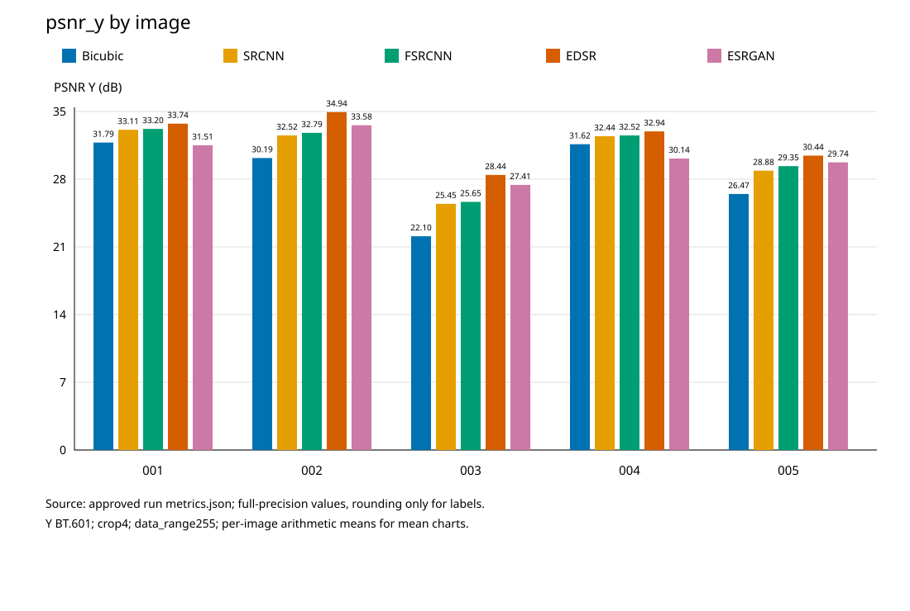
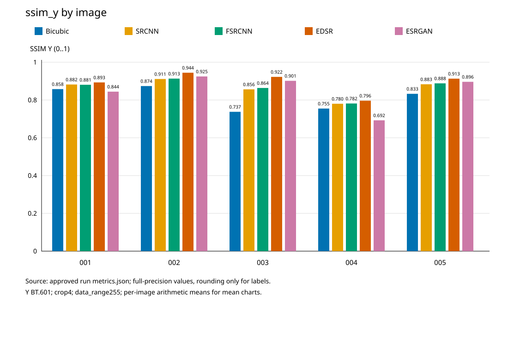
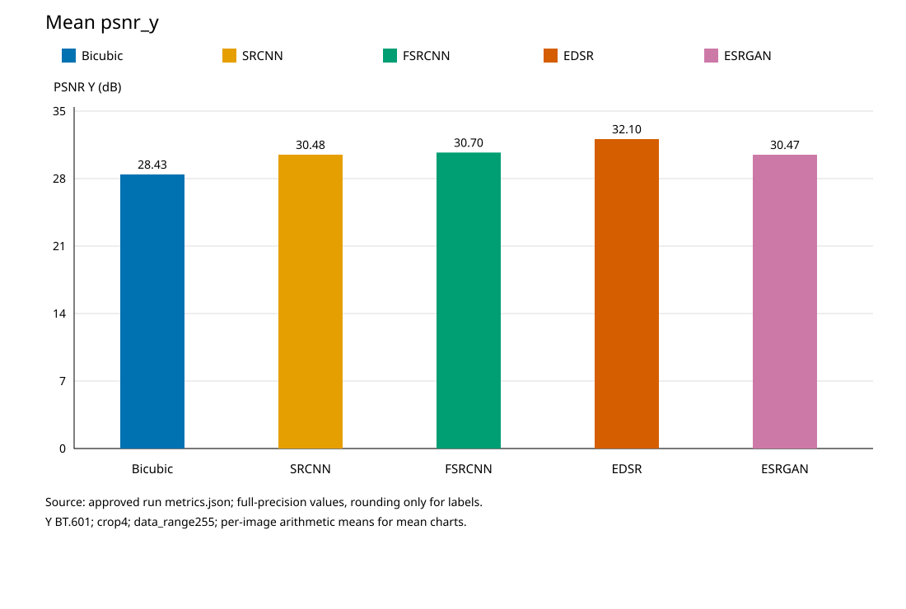
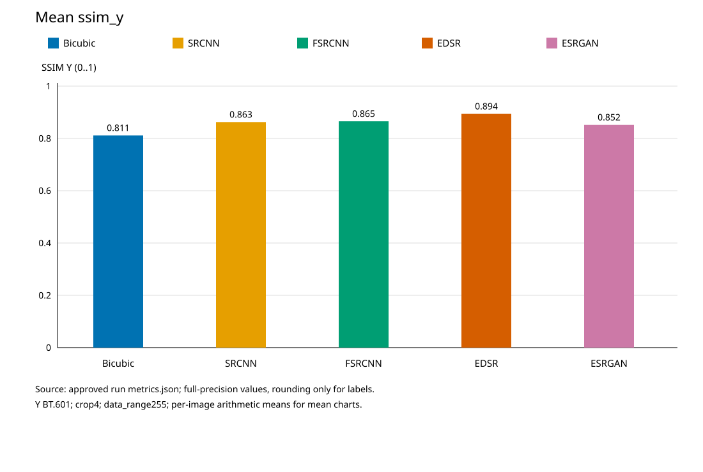
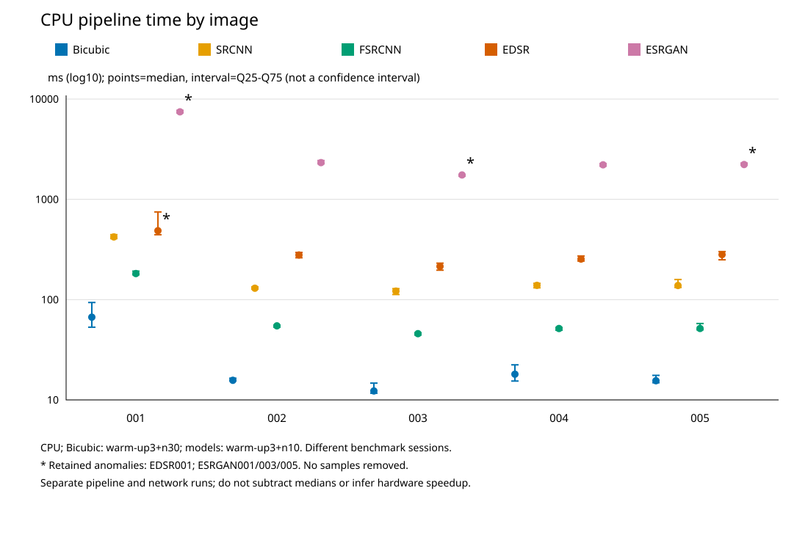
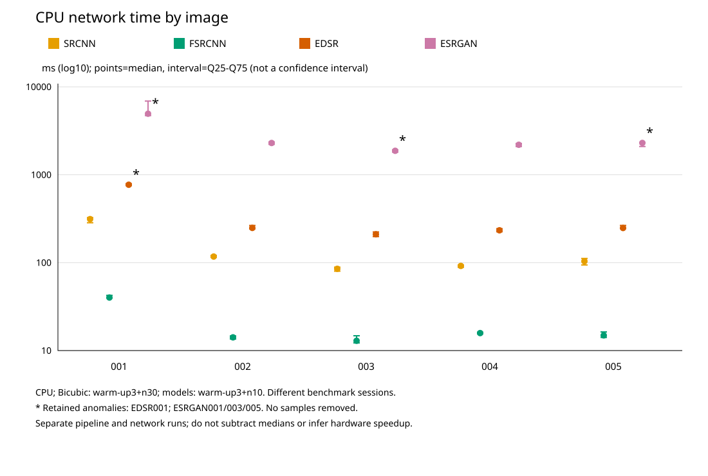

# M7 — So sánh năm thuật toán Super Resolution ×4

## Phạm vi và nguồn

Tổng hợp chỉ đọc năm run đã nghiệm thu, không chạy lại inference/benchmark. Mỗi run đúng năm ảnh SelfExSR Set5; Y BT.601 float/crop4/range255/Gaussian SSIM11 sigma1.5 nguyên M1, RGB bổ sung. Không dùng diagnostic Y uint8 để xếp hạng. Đây không phải human study hoặc nghiệm thu chính thức của nhà trường.

- Bicubic: `set5_numpy_x4_20261108_1627`, metrics.json SHA-256 `798f7a67c4dc5c7214a4fb3b43718f1061e41a293bdb1296f92a752ebb33403f`.
- SRCNN: `set5_srcnn955_x4_20261108_201641`, metrics.json SHA-256 `43ad15c4dc1612d69a0f0e29019abbf2c590aab0d5392a2613ff998e8876a5c2`.
- FSRCNN: `set5_fsrcnn56124_x4_20261109_043641`, metrics.json SHA-256 `f746f4b0f3998935014bfc6025bd88793d3baf4603455e0d9a3b1877faaaa40b`.
- EDSR: `set5_edsr_baseline_x4_20261109_034132`, metrics.json SHA-256 `c6cc92658ad2c83851a09832212d91e0c39e7b50f2ec26ce8b3abef7a646dc87`.
- ESRGAN: `set5_esrgan_x4_20261109_060235`, metrics.json SHA-256 `c4c616ff5a34ece81c696cc3f397b33843902de963ad80fcba01f103fb27633f`.

M1 không có trường run_id: nhận diện bằng whitelist thư mục + hash + backend NumPy/scale4. Nguồn hash JSON/environment/5HR/25SR: [sources.json](comparison/manifests/sources.json). Nhãn checkpoint: FSRCNN là bản đăng lại, CUHK/selection chưa xác minh; ESRGAN là Original ESRGAN architecture với BasicSR converted checkpoint, conversion chain/weight license/train overlap UNVERIFIED. Các nguồn và pipeline khác nhau làm so sánh này không phải ablation có kiểm soát.

## Bảng định lượng

EDSR đứng đầu cả PSNR Y và SSIM Y trung bình trong năm run này; chất lượng cảm nhận không được dùng để thay đổi kết luận về độ chính xác tái tạo.

- [25 record, bốn metric](comparison/tables/per_image.md) — [CSV đầy đủ](comparison/tables/per_image.csv).
- [Trung bình](comparison/tables/mean.md) — [CSV](comparison/tables/mean.csv).
- [Delta so với Bicubic](comparison/tables/delta_bicubic.md) — [CSV](comparison/tables/delta_bicubic.csv).
- [Thời gian pipeline](comparison/tables/timing_pipeline.md) — [CSV](comparison/tables/timing_pipeline.csv).
- [Thời gian chỉ mạng](comparison/tables/timing_network.md) — [CSV](comparison/tables/timing_network.csv).

CSV dùng .17g để giữ full-precision float; Markdown chỉ hiển thị PSNR4/SSIM6/timing3. Mean tính từ năm số gốc và đối chiếu stored mean atol1e-9, không PSNR từ MSE gộp. Delta=thuật toán−Bicubic cùng ảnh.

Thứ hạng PSNR Y trung bình: EDSR32.0979 > FSRCNN30.7016 > SRCNN30.4806 > ESRGAN30.4742 > Bicubic28.4318. ESRGAN gần SRCNN, thấp hơn FSRCNN/EDSR; không diễn giải hai số gần nhau là bằng nhau hoặc đổi thứ hạng theo cảm giác sắc. ESRGAN kém Bicubic img_001 về PSNR Y (và SSIM Y), img_004 cả PSNR/SSIM Y. Các ảnh khác có chiều delta khác, không chọn một ảnh để đại diện toàn bộ.

## Sáu biểu đồ thuần số

### psnr_y_per_image



PSNR Y từng ảnh: mức tăng khác nhau theo ảnh; không ép thứ hạng theo kỳ vọng thuật toán. Giả thuyết kiến trúc/cách xử lý có thể góp phần, nhưng dữ liệu huấn luyện và trạng thái máy khác nhau hạn chế kết luận nhân quả.

### ssim_y_per_image



SSIM Y từng ảnh: độ khớp cấu trúc có thể không cùng thứ hạng với PSNR; không phải sở thích cảm nhận. Giả thuyết kiến trúc/cách xử lý có thể góp phần, nhưng dữ liệu huấn luyện và trạng thái máy khác nhau hạn chế kết luận nhân quả.

### mean_psnr_y



PSNR Y trung bình: ESRGAN gần SRCNN nhưng thấp hơn FSRCNN và EDSR, chỉ năm ảnh/checkpoint này. Giả thuyết kiến trúc/cách xử lý có thể góp phần, nhưng dữ liệu huấn luyện và trạng thái máy khác nhau hạn chế kết luận nhân quả.

### mean_ssim_y



SSIM Y trung bình: ESRGAN nằm giữa Bicubic và các mô hình tái tạo khác; không chung trục với PSNR. Giả thuyết kiến trúc/cách xử lý có thể góp phần, nhưng dữ liệu huấn luyện và trạng thái máy khác nhau hạn chế kết luận nhân quả.

### pipeline_time_per_image



Toàn pipeline: chênh lệch công việc màu/resize và mạng, không suy tốc độ phần cứng từ các phiên đo khác nhau. Giả thuyết kiến trúc/cách xử lý có thể góp phần, nhưng dữ liệu huấn luyện và trạng thái máy khác nhau hạn chế kết luận nhân quả.

### network_time_per_image



Chỉ mạng: bốn model, Bicubic không có; không gộp scope hoặc lấy hiệu median làm overhead. Giả thuyết kiến trúc/cách xử lý có thể góp phần, nhưng dữ liệu huấn luyện và trạng thái máy khác nhau hạn chế kết luận nhân quả.

Biểu đồ SVG deterministic không timestamp/UUID, không nhúng pixel Set5. Timing là point median + Q25–Q75 từ raw samples, trục log ms; khoảng này không phải CI. Bicubic warm-up3+n30, mạng warm-up3+n10. Benchmark khác phiên; giữ mọi sample và dấu * ở EDSR img_001, ESRGAN img_001/003/005. ESRGAN img_001 có forward IQR lớn; EDSR img_001 và ESRGAN img_003/005 forward lớn hơn pipeline ở hai loạt riêng. Chưa đo tải nền/nhiệt để giải thích; không quy cho GAN hoặc bỏ điểm. Không làm kiểm định speedup.

## Crop khóa và lịch sử quan sát

**Nhóm đã xem SR trước khi xây dựng quy tắc**: crop giữa M6, sanity Set14 và các contact sheet trước. Ba quy tắc thuật toán HR-only giảm cherry-picking nhưng không khôi phục được trạng thái quan sát mù hay tiền đăng ký trước mọi quan sát.

Chọn crop chỉ đọc5 HR, không đọc SR/metric/timing. BT.601 lượng tử để chọn crop: V=65481R+128553G+24966B int64; Y=16+(V+127500)//255000. Đây là feature chọn vùng, không thay metric Y float M1. Gradient là tổng bình phương các cặp ngang/dọc nội bộ64×64; lowgrad chỉ xét NΣY²−(ΣY)²≥4N², N4096, kiểm hoàn toàn bằng số nguyên; không float std. Hòa điểm chọn y rồi x nhỏ nhất. Center dùng floor((W−64)/2),floor((H−64)/2). Trùng tọa độ giữ nguyên, không tìm thay thế; không có lowgrad hợp lệ thì dừng.

Manifest: [crop_manifest.json](comparison/crop_manifest.json),15record, locked UTC `2026-11-09T06:57:54.735751+00:00`, SHA-256 `0f37d1901fae432e896aba6e4b8470a84cb9bc174a570a8fe9a14e08fb8e1b22`. Receipt cục bộ `logs/m7_crop_lock.log`; first sheet render UTC `2026-11-09T06:58:06.299068+00:00` sau khóa. Receipt source selector và5HR đã kiểm; code hash:

- `scripts/build_contact_sheets.py`: `e31308c058c581416faceea0d52408e21fe9756211c72da484be6a0dd54aa113`.
- `src/sr_compare/comparison_crops.py`: `5a0d127e273db024687802a11ee2dec81b83fc38a675c0a50cd7bdf36624bce9`.

Nguồn ảnh được khóa riêng ở [source_lock.json](comparison/manifests/source_lock.json): UTC `2026-11-09T06:58:00.698616+00:00`, SHA-256 source snapshot `c36d39dc1ef8e37116b67f97e0d1b2cbbc57aeb23da1e9767a0e93099ea95967`. Kiểm toàn bộ40file trước/sau render, không chỉ lấy hash tại lúc đã thay ảnh.

| Ảnh | Rule | x | y | Score gradient | Trùng |
|---|---|---:|---:|---:|---|
| img_001_SRF_4 | hr_gradient64_v1 | 182 | 27 | 1738854 | False |
| img_001_SRF_4 | hr_lowgrad64_v1 | 352 | 264 | 15069 | False |
| img_001_SRF_4 | center64_v1 | 224 | 224 | 256677 | False |
| img_002_SRF_4 | hr_gradient64_v1 | 132 | 20 | 1745997 | False |
| img_002_SRF_4 | hr_lowgrad64_v1 | 64 | 151 | 5780 | False |
| img_002_SRF_4 | center64_v1 | 112 | 112 | 878319 | False |
| img_003_SRF_4 | hr_gradient64_v1 | 0 | 25 | 6484053 | False |
| img_003_SRF_4 | hr_lowgrad64_v1 | 0 | 192 | 338148 | False |
| img_003_SRF_4 | center64_v1 | 96 | 96 | 3823755 | False |
| img_004_SRF_4 | hr_gradient64_v1 | 26 | 195 | 1107239 | False |
| img_004_SRF_4 | hr_lowgrad64_v1 | 2 | 37 | 116670 | False |
| img_004_SRF_4 | center64_v1 | 108 | 108 | 575022 | False |
| img_005_SRF_4 | hr_gradient64_v1 | 4 | 1 | 6094441 | False |
| img_005_SRF_4 | hr_lowgrad64_v1 | 0 | 258 | 158266 | False |
| img_005_SRF_4 | center64_v1 | 82 | 140 | 563059 | False |

Mọi crop64×64 phóng nearest×4. Manifest chứa sum_y/sum_y2/variance_numerator cho cả15record, điều kiện std bắt buộc riêng lowgrad. Lowgrad có thể chọn nền rất tối như img_002/004: đây là giới hạn tiêu chí gradient, không tự đổi vùng vì ít đẹp hoặc ít thông tin. Không chỉnh brightness để làm vùng tối dễ thấy. Nền gần đen ở hai ảnh này là hạn chế của phương pháp chọn crop, không phải lý do sửa manifest v1 hoặc thay các crop chính thức đã khóa.

## Vị trí contact sheet — chỉ cục bộ, không commit

Thứ tự HR | Bicubic | SRCNN | FSRCNN | EDSR | ESRGAN; nhãn/run_id đầy đủ. Full native giữ nguyên kích thước, thêm canvas nhãn bên ngoài; crop nearest4 giữ cùng tọa độ. Không chỉnh màu/contrast/sáng. Ảnh dữ liệu hoặc phái sinh không có trong repository; các đường dẫn dưới đây cần bộ artifact cục bộ:

- img_001: `results/comparison/m7_v1/full/full_img_001_SRF_4.png`; ba crop ở `results/comparison/m7_v1/crops/crop_img_001_SRF_4_{hr_gradient64_v1,hr_lowgrad64_v1,center64_v1}.png`.
- img_002: `results/comparison/m7_v1/full/full_img_002_SRF_4.png`; ba crop ở `results/comparison/m7_v1/crops/crop_img_002_SRF_4_{hr_gradient64_v1,hr_lowgrad64_v1,center64_v1}.png`.
- img_003: `results/comparison/m7_v1/full/full_img_003_SRF_4.png`; ba crop ở `results/comparison/m7_v1/crops/crop_img_003_SRF_4_{hr_gradient64_v1,hr_lowgrad64_v1,center64_v1}.png`.
- img_004: `results/comparison/m7_v1/full/full_img_004_SRF_4.png`; ba crop ở `results/comparison/m7_v1/crops/crop_img_004_SRF_4_{hr_gradient64_v1,hr_lowgrad64_v1,center64_v1}.png`.
- img_005: `results/comparison/m7_v1/full/full_img_005_SRF_4.png`; ba crop ở `results/comparison/m7_v1/crops/crop_img_005_SRF_4_{hr_gradient64_v1,hr_lowgrad64_v1,center64_v1}.png`.

## 25 nhận xét: Quan sát → Giả thuyết → Giới hạn

Các nhận xét dưới đây dựa trên full sheet và đủ ba crop đã xem. Không có human study/LPIPS; quan sát sắc nét không đồng nghĩa độ chính xác. Không đo riêng ringing/màu bằng chỉ số mới. Chưa thấy checkerboard/lệch hình học rõ ở các vùng được xem, không chứng minh vắng artifact ở toàn ảnh. Tone màu chính được mô tả định tính, không thay metric RGB.

### img_001_SRF_4 — Bicubic

**Quan sát:** Biên mũ và lỗ mũi mềm; ô gradient mất nhiều chi tiết sợi đan, da ở center/lowgrad mịn hơn HR. Màu: tone da cam nhạt và màu mũ còn nhận ra; không khẳng định trùng màu từng pixel. Artifact: chưa thấy bàn cờ/lệch hình học rõ; khác biệt hạt/vệt đã nêu cần xét riêng. Chưa thấy texture mới rõ vượt HR trong các crop này; không suy ra mọi chi tiết đều đúng hoặc không có artifact.

Metric nguồn: PSNR Y 31.7864, SSIM Y 0.857656; PSNR RGB 30.3696, SSIM RGB 0.828789. ΔY soBicubic +0.0000dB / +0.000000. Bằng chứng vùng: hr_gradient64_v1,hr_lowgrad64_v1,center64_v1 cùngimage_id; số liệu chỉ đọc JSON, không tính lại trên crop.

**Giả thuyết:** nội suy cubic chỉ phối hợp lân cận LR, nên giảm nhòe có giới hạn và không học texture đã mất; không suy ra mọi mảng mịn đều là lỗi hình học.

**Giới hạn:** ba vùng không đại diện mọi cấu trúc toàn ảnh; một ảnh/checkpoint, không ablation. Vùng lowgrad tối có thể không phân biệt được mô hình bằng mắt; không tăng sáng hay chọn lại vùng. Không xếp hạng cảm nhận như kết quả khảo sát và không khẳng định ESRGAN tốt hơn EDSR.

### img_001_SRF_4 — SRCNN

**Quan sát:** Biên mũ và mũi rõ hơn Bicubic; các mảng đan phân tách hơn nhưng nhiều sợi nhỏ HR vẫn hòa vào nhau; da lowgrad vẫn mịn. Màu: tone da cam nhạt và màu mũ còn nhận ra; không khẳng định trùng màu từng pixel. Artifact: chưa thấy bàn cờ/lệch hình học rõ; khác biệt hạt/vệt đã nêu cần xét riêng. Chưa thấy texture mới rõ vượt HR trong các crop này; không suy ra mọi chi tiết đều đúng hoặc không có artifact.

Metric nguồn: PSNR Y 33.1059, SSIM Y 0.881985; PSNR RGB 31.5312, SSIM RGB 0.853106. ΔY soBicubic +1.3195dB / +0.024328. Bằng chứng vùng: hr_gradient64_v1,hr_lowgrad64_v1,center64_v1 cùngimage_id; số liệu chỉ đọc JSON, không tính lại trên crop.

**Giả thuyết:** ánh xạ phi tuyến học được trên ảnh đã bicubic ở HR làm rõ một số cạnh; checkpoint và dữ liệu huấn luyện khác mô hình khác nên đây không phải ablation của riêng số lớp.

**Giới hạn:** ba vùng không đại diện mọi cấu trúc toàn ảnh; một ảnh/checkpoint, không ablation. Vùng lowgrad tối có thể không phân biệt được mô hình bằng mắt; không tăng sáng hay chọn lại vùng. Không xếp hạng cảm nhận như kết quả khảo sát và không khẳng định ESRGAN tốt hơn EDSR.

### img_001_SRF_4 — FSRCNN

**Quan sát:** Đường tối trên mũ và mũi rõ hơn Bicubic; cấu trúc đan có hình dạng nhưng chưa theo đủ sợi HR; lowgrad da gần SRCNN, khác biệt nhỏ bằng mắt. Màu: tone da cam nhạt và màu mũ còn nhận ra; không khẳng định trùng màu từng pixel. Artifact: chưa thấy bàn cờ/lệch hình học rõ; khác biệt hạt/vệt đã nêu cần xét riêng. Chưa thấy texture mới rõ vượt HR trong các crop này; không suy ra mọi chi tiết đều đúng hoặc không có artifact.

Metric nguồn: PSNR Y 33.1969, SSIM Y 0.880664; PSNR RGB 31.6129, SSIM RGB 0.851260. ΔY soBicubic +1.4104dB / +0.023008. Bằng chứng vùng: hr_gradient64_v1,hr_lowgrad64_v1,center64_v1 cùngimage_id; số liệu chỉ đọc JSON, không tính lại trên crop.

**Giả thuyết:** shrinking/mapping/expanding ở LR và deconv cuối tạo ánh xạ khác SRCNN với ít tham số; không thể quy riêng chênh lệch metric cho deconv hoặc số tham số khi training khác.

**Giới hạn:** ba vùng không đại diện mọi cấu trúc toàn ảnh; một ảnh/checkpoint, không ablation. Vùng lowgrad tối có thể không phân biệt được mô hình bằng mắt; không tăng sáng hay chọn lại vùng. Không xếp hạng cảm nhận như kết quả khảo sát và không khẳng định ESRGAN tốt hơn EDSR.

### img_001_SRF_4 — EDSR

**Quan sát:** Biên mũ, mắt và mũi gọn; đường đan tương đối mượt, texture sợi nhỏ vẫn ít hơn HR; lowgrad da giữ chuyển sắc mịn. Màu: tone da cam nhạt và màu mũ còn nhận ra; không khẳng định trùng màu từng pixel. Artifact: chưa thấy bàn cờ/lệch hình học rõ; khác biệt hạt/vệt đã nêu cần xét riêng. Chưa thấy texture mới rõ vượt HR trong các crop này; không suy ra mọi chi tiết đều đúng hoặc không có artifact.

Metric nguồn: PSNR Y 33.7413, SSIM Y 0.893056; PSNR RGB 32.2370, SSIM RGB 0.868109. ΔY soBicubic +1.9548dB / +0.035399. Bằng chứng vùng: hr_gradient64_v1,hr_lowgrad64_v1,center64_v1 cùngimage_id; số liệu chỉ đọc JSON, không tính lại trên crop.

**Giả thuyết:** residual learning sâu, không BN và PixelShuffle hỗ trợ ánh xạ tái tạo; dữ liệu DIV2K và objective khác là yếu tố nhiễu, không chứng minh nguyên nhân bằng một crop.

**Giới hạn:** ba vùng không đại diện mọi cấu trúc toàn ảnh; một ảnh/checkpoint, không ablation. Vùng lowgrad tối có thể không phân biệt được mô hình bằng mắt; không tăng sáng hay chọn lại vùng. Không xếp hạng cảm nhận như kết quả khảo sát và không khẳng định ESRGAN tốt hơn EDSR.

### img_001_SRF_4 — ESRGAN

**Quan sát:** Biên mũ/mắt rõ và vùng da có hạt nhỏ; gradient cho sợi mũ có texture mạnh hơn các ảnh mịn, nhưng không trùng từng chi tiết HR. PSNR Y/SSIM Y thấp hơn Bicubic, không thể lấy độ sắc để bỏ qua kết quả này. Màu: tone da cam nhạt và màu mũ còn nhận ra; không khẳng định trùng màu từng pixel. Artifact: chưa thấy bàn cờ/lệch hình học rõ; khác biệt hạt/vệt đã nêu cần xét riêng. Texture thêm không bảo đảm tồn tại ở HR; có thể khác hạt/vệt của nguồn.

Metric nguồn: PSNR Y 31.5053, SSIM Y 0.844198; PSNR RGB 29.9608, SSIM RGB 0.809906. ΔY soBicubic -0.2812dB / -0.013458. Bằng chứng vùng: hr_gradient64_v1,hr_lowgrad64_v1,center64_v1 cùngimage_id; số liệu chỉ đọc JSON, không tính lại trên crop.

**Giả thuyết:** thiết kế GAN/perceptual và dense residual có thể ưu tiên texture tần số cao trông hợp lý. Đây không phải giải thích mặc nhiên: checkpoint, degradation và sai khác xử lý cũng cần xem xét; không có ablation xác định nhân quả.

**Giới hạn:** ba vùng không đại diện mọi cấu trúc toàn ảnh; một ảnh/checkpoint, không ablation. Vùng lowgrad tối có thể không phân biệt được mô hình bằng mắt; không tăng sáng hay chọn lại vùng. Không xếp hạng cảm nhận như kết quả khảo sát và không khẳng định ESRGAN tốt hơn EDSR.

### img_002_SRF_4 — Bicubic

**Quan sát:** Biên mắt/mỏ và dải vàng mềm, một số ranh giới hòa nhau; center thiếu cấu trúc nhỏ ở mép lông; lowgrad gần đen ít thông tin. Màu: tone vàng–xanh/đen của chim còn nhận ra; không khẳng định trùng màu từng pixel. Artifact: chưa thấy bàn cờ/lệch hình học rõ; khác biệt hạt/vệt đã nêu cần xét riêng. Chưa thấy texture mới rõ vượt HR trong các crop này; không suy ra mọi chi tiết đều đúng hoặc không có artifact.

Metric nguồn: PSNR Y 30.1870, SSIM Y 0.873809; PSNR RGB 28.2188, SSIM RGB 0.848754. ΔY soBicubic +0.0000dB / +0.000000. Bằng chứng vùng: hr_gradient64_v1,hr_lowgrad64_v1,center64_v1 cùngimage_id; số liệu chỉ đọc JSON, không tính lại trên crop.

**Giả thuyết:** nội suy cubic chỉ phối hợp lân cận LR, nên giảm nhòe có giới hạn và không học texture đã mất; không suy ra mọi mảng mịn đều là lỗi hình học.

**Giới hạn:** ba vùng không đại diện mọi cấu trúc toàn ảnh; một ảnh/checkpoint, không ablation. Vùng lowgrad tối có thể không phân biệt được mô hình bằng mắt; không tăng sáng hay chọn lại vùng. Không xếp hạng cảm nhận như kết quả khảo sát và không khẳng định ESRGAN tốt hơn EDSR.

### img_002_SRF_4 — SRCNN

**Quan sát:** Mắt và ranh giới vàng–đen rõ hơn Bicubic; vùng vàng ở center còn khá mịn so HR; lowgrad gần đen không cho thấy khác biệt lớn. Màu: tone vàng–xanh/đen của chim còn nhận ra; không khẳng định trùng màu từng pixel. Artifact: chưa thấy bàn cờ/lệch hình học rõ; khác biệt hạt/vệt đã nêu cần xét riêng. Chưa thấy texture mới rõ vượt HR trong các crop này; không suy ra mọi chi tiết đều đúng hoặc không có artifact.

Metric nguồn: PSNR Y 32.5231, SSIM Y 0.911089; PSNR RGB 29.8432, SSIM RGB 0.871615. ΔY soBicubic +2.3360dB / +0.037281. Bằng chứng vùng: hr_gradient64_v1,hr_lowgrad64_v1,center64_v1 cùngimage_id; số liệu chỉ đọc JSON, không tính lại trên crop.

**Giả thuyết:** ánh xạ phi tuyến học được trên ảnh đã bicubic ở HR làm rõ một số cạnh; checkpoint và dữ liệu huấn luyện khác mô hình khác nên đây không phải ablation của riêng số lớp.

**Giới hạn:** ba vùng không đại diện mọi cấu trúc toàn ảnh; một ảnh/checkpoint, không ablation. Vùng lowgrad tối có thể không phân biệt được mô hình bằng mắt; không tăng sáng hay chọn lại vùng. Không xếp hạng cảm nhận như kết quả khảo sát và không khẳng định ESRGAN tốt hơn EDSR.

### img_002_SRF_4 — FSRCNN

**Quan sát:** Mắt/mỏ rõ hơn Bicubic; center có biến thiên nhỏ ở vùng vàng nhưng chưa trùng các sợi lông HR; nền tối lowgrad ít khác biệt rõ. Màu: tone vàng–xanh/đen của chim còn nhận ra; không khẳng định trùng màu từng pixel. Artifact: chưa thấy bàn cờ/lệch hình học rõ; khác biệt hạt/vệt đã nêu cần xét riêng. Chưa thấy texture mới rõ vượt HR trong các crop này; không suy ra mọi chi tiết đều đúng hoặc không có artifact.

Metric nguồn: PSNR Y 32.7881, SSIM Y 0.913179; PSNR RGB 29.9973, SSIM RGB 0.872601. ΔY soBicubic +2.6011dB / +0.039370. Bằng chứng vùng: hr_gradient64_v1,hr_lowgrad64_v1,center64_v1 cùngimage_id; số liệu chỉ đọc JSON, không tính lại trên crop.

**Giả thuyết:** shrinking/mapping/expanding ở LR và deconv cuối tạo ánh xạ khác SRCNN với ít tham số; không thể quy riêng chênh lệch metric cho deconv hoặc số tham số khi training khác.

**Giới hạn:** ba vùng không đại diện mọi cấu trúc toàn ảnh; một ảnh/checkpoint, không ablation. Vùng lowgrad tối có thể không phân biệt được mô hình bằng mắt; không tăng sáng hay chọn lại vùng. Không xếp hạng cảm nhận như kết quả khảo sát và không khẳng định ESRGAN tốt hơn EDSR.

### img_002_SRF_4 — EDSR

**Quan sát:** Đường mỏ và mắt tương đối gọn; center vẫn mịn hơn các sợi lông HR; lowgrad tối không có cấu trúc lớn để phân biệt đáng tin cậy. Màu: tone vàng–xanh/đen của chim còn nhận ra; không khẳng định trùng màu từng pixel. Artifact: chưa thấy bàn cờ/lệch hình học rõ; khác biệt hạt/vệt đã nêu cần xét riêng. Chưa thấy texture mới rõ vượt HR trong các crop này; không suy ra mọi chi tiết đều đúng hoặc không có artifact.

Metric nguồn: PSNR Y 34.9373, SSIM Y 0.944407; PSNR RGB 32.7290, SSIM RGB 0.925218. ΔY soBicubic +4.7503dB / +0.070598. Bằng chứng vùng: hr_gradient64_v1,hr_lowgrad64_v1,center64_v1 cùngimage_id; số liệu chỉ đọc JSON, không tính lại trên crop.

**Giả thuyết:** residual learning sâu, không BN và PixelShuffle hỗ trợ ánh xạ tái tạo; dữ liệu DIV2K và objective khác là yếu tố nhiễu, không chứng minh nguyên nhân bằng một crop.

**Giới hạn:** ba vùng không đại diện mọi cấu trúc toàn ảnh; một ảnh/checkpoint, không ablation. Vùng lowgrad tối có thể không phân biệt được mô hình bằng mắt; không tăng sáng hay chọn lại vùng. Không xếp hạng cảm nhận như kết quả khảo sát và không khẳng định ESRGAN tốt hơn EDSR.

### img_002_SRF_4 — ESRGAN

**Quan sát:** Mắt/mỏ sắc, center có các biến thiên lông nhỏ; trong vùng tối lowgrad chưa thấy khác biệt lớn. Không xác nhận các texture nhỏ được phục hồi đúng vị trí HR. Màu: tone vàng–xanh/đen của chim còn nhận ra; không khẳng định trùng màu từng pixel. Artifact: chưa thấy bàn cờ/lệch hình học rõ; khác biệt hạt/vệt đã nêu cần xét riêng. Texture thêm không bảo đảm tồn tại ở HR; có thể khác hạt/vệt của nguồn.

Metric nguồn: PSNR Y 33.5788, SSIM Y 0.924691; PSNR RGB 30.9558, SSIM RGB 0.887028. ΔY soBicubic +3.3918dB / +0.050882. Bằng chứng vùng: hr_gradient64_v1,hr_lowgrad64_v1,center64_v1 cùngimage_id; số liệu chỉ đọc JSON, không tính lại trên crop.

**Giả thuyết:** thiết kế GAN/perceptual và dense residual có thể ưu tiên texture tần số cao trông hợp lý. Đây không phải giải thích mặc nhiên: checkpoint, degradation và sai khác xử lý cũng cần xem xét; không có ablation xác định nhân quả.

**Giới hạn:** ba vùng không đại diện mọi cấu trúc toàn ảnh; một ảnh/checkpoint, không ablation. Vùng lowgrad tối có thể không phân biệt được mô hình bằng mắt; không tăng sáng hay chọn lại vùng. Không xếp hạng cảm nhận như kết quả khảo sát và không khẳng định ESRGAN tốt hơn EDSR.

### img_003_SRF_4 — Bicubic

**Quan sát:** Biên đen–vàng và các đốm trắng bị mờ/hòa; vùng vàng center mất hạt nhỏ của HR; lowgrad bokeh mềm. Màu: tone vàng–đen/hồng của cánh và nền còn nhận ra; không khẳng định trùng màu từng pixel. Artifact: chưa thấy bàn cờ/lệch hình học rõ; khác biệt hạt/vệt đã nêu cần xét riêng. Chưa thấy texture mới rõ vượt HR trong các crop này; không suy ra mọi chi tiết đều đúng hoặc không có artifact.

Metric nguồn: PSNR Y 22.1010, SSIM Y 0.737484; PSNR RGB 20.8651, SSIM RGB 0.701227. ΔY soBicubic +0.0000dB / +0.000000. Bằng chứng vùng: hr_gradient64_v1,hr_lowgrad64_v1,center64_v1 cùngimage_id; số liệu chỉ đọc JSON, không tính lại trên crop.

**Giả thuyết:** nội suy cubic chỉ phối hợp lân cận LR, nên giảm nhòe có giới hạn và không học texture đã mất; không suy ra mọi mảng mịn đều là lỗi hình học.

**Giới hạn:** ba vùng không đại diện mọi cấu trúc toàn ảnh; một ảnh/checkpoint, không ablation. Vùng lowgrad tối có thể không phân biệt được mô hình bằng mắt; không tăng sáng hay chọn lại vùng. Không xếp hạng cảm nhận như kết quả khảo sát và không khẳng định ESRGAN tốt hơn EDSR.

### img_003_SRF_4 — SRCNN

**Quan sát:** Các đốm trắng tách rõ hơn Bicubic và biên cánh gọn hơn; vùng vàng center khá trơn, chi tiết vi mô HR còn thiếu. Màu: tone vàng–đen/hồng của cánh và nền còn nhận ra; không khẳng định trùng màu từng pixel. Artifact: chưa thấy bàn cờ/lệch hình học rõ; khác biệt hạt/vệt đã nêu cần xét riêng. Chưa thấy texture mới rõ vượt HR trong các crop này; không suy ra mọi chi tiết đều đúng hoặc không có artifact.

Metric nguồn: PSNR Y 25.4520, SSIM Y 0.856361; PSNR RGB 24.0561, SSIM RGB 0.828242. ΔY soBicubic +3.3510dB / +0.118877. Bằng chứng vùng: hr_gradient64_v1,hr_lowgrad64_v1,center64_v1 cùngimage_id; số liệu chỉ đọc JSON, không tính lại trên crop.

**Giả thuyết:** ánh xạ phi tuyến học được trên ảnh đã bicubic ở HR làm rõ một số cạnh; checkpoint và dữ liệu huấn luyện khác mô hình khác nên đây không phải ablation của riêng số lớp.

**Giới hạn:** ba vùng không đại diện mọi cấu trúc toàn ảnh; một ảnh/checkpoint, không ablation. Vùng lowgrad tối có thể không phân biệt được mô hình bằng mắt; không tăng sáng hay chọn lại vùng. Không xếp hạng cảm nhận như kết quả khảo sát và không khẳng định ESRGAN tốt hơn EDSR.

### img_003_SRF_4 — FSRCNN

**Quan sát:** Biên cánh và các đốm trắng rõ hơn Bicubic; center có biến thiên nhỏ nhưng chưa tái tạo đủ hình dạng đốm/biên HR; bokeh lowgrad vẫn mềm. Màu: tone vàng–đen/hồng của cánh và nền còn nhận ra; không khẳng định trùng màu từng pixel. Artifact: chưa thấy bàn cờ/lệch hình học rõ; khác biệt hạt/vệt đã nêu cần xét riêng. Chưa thấy texture mới rõ vượt HR trong các crop này; không suy ra mọi chi tiết đều đúng hoặc không có artifact.

Metric nguồn: PSNR Y 25.6534, SSIM Y 0.863685; PSNR RGB 24.2440, SSIM RGB 0.836059. ΔY soBicubic +3.5524dB / +0.126201. Bằng chứng vùng: hr_gradient64_v1,hr_lowgrad64_v1,center64_v1 cùngimage_id; số liệu chỉ đọc JSON, không tính lại trên crop.

**Giả thuyết:** shrinking/mapping/expanding ở LR và deconv cuối tạo ánh xạ khác SRCNN với ít tham số; không thể quy riêng chênh lệch metric cho deconv hoặc số tham số khi training khác.

**Giới hạn:** ba vùng không đại diện mọi cấu trúc toàn ảnh; một ảnh/checkpoint, không ablation. Vùng lowgrad tối có thể không phân biệt được mô hình bằng mắt; không tăng sáng hay chọn lại vùng. Không xếp hạng cảm nhận như kết quả khảo sát và không khẳng định ESRGAN tốt hơn EDSR.

### img_003_SRF_4 — EDSR

**Quan sát:** Đốm trắng và viền đen–vàng phân tách tốt trong crop gradient; vùng vàng center tương đối mượt so texture HR; lowgrad không cần sinh cạnh mới. Màu: tone vàng–đen/hồng của cánh và nền còn nhận ra; không khẳng định trùng màu từng pixel. Artifact: chưa thấy bàn cờ/lệch hình học rõ; khác biệt hạt/vệt đã nêu cần xét riêng. Chưa thấy texture mới rõ vượt HR trong các crop này; không suy ra mọi chi tiết đều đúng hoặc không có artifact.

Metric nguồn: PSNR Y 28.4371, SSIM Y 0.922383; PSNR RGB 26.9985, SSIM RGB 0.902201. ΔY soBicubic +6.3361dB / +0.184899. Bằng chứng vùng: hr_gradient64_v1,hr_lowgrad64_v1,center64_v1 cùngimage_id; số liệu chỉ đọc JSON, không tính lại trên crop.

**Giả thuyết:** residual learning sâu, không BN và PixelShuffle hỗ trợ ánh xạ tái tạo; dữ liệu DIV2K và objective khác là yếu tố nhiễu, không chứng minh nguyên nhân bằng một crop.

**Giới hạn:** ba vùng không đại diện mọi cấu trúc toàn ảnh; một ảnh/checkpoint, không ablation. Vùng lowgrad tối có thể không phân biệt được mô hình bằng mắt; không tăng sáng hay chọn lại vùng. Không xếp hạng cảm nhận như kết quả khảo sát và không khẳng định ESRGAN tốt hơn EDSR.

### img_003_SRF_4 — ESRGAN

**Quan sát:** Viền cánh/đốm trắng rõ, vùng vàng có texture hạt; một số viền/texture nhỏ khác HR. Độ nét này không chứng minh chi tiết vi mô đúng dù metric cao hơn Bicubic. Màu: tone vàng–đen/hồng của cánh và nền còn nhận ra; không khẳng định trùng màu từng pixel. Artifact: chưa thấy bàn cờ/lệch hình học rõ; khác biệt hạt/vệt đã nêu cần xét riêng. Texture thêm không bảo đảm tồn tại ở HR; có thể khác hạt/vệt của nguồn.

Metric nguồn: PSNR Y 27.4086, SSIM Y 0.901454; PSNR RGB 25.8631, SSIM RGB 0.872726. ΔY soBicubic +5.3076dB / +0.163970. Bằng chứng vùng: hr_gradient64_v1,hr_lowgrad64_v1,center64_v1 cùngimage_id; số liệu chỉ đọc JSON, không tính lại trên crop.

**Giả thuyết:** thiết kế GAN/perceptual và dense residual có thể ưu tiên texture tần số cao trông hợp lý. Đây không phải giải thích mặc nhiên: checkpoint, degradation và sai khác xử lý cũng cần xem xét; không có ablation xác định nhân quả.

**Giới hạn:** ba vùng không đại diện mọi cấu trúc toàn ảnh; một ảnh/checkpoint, không ablation. Vùng lowgrad tối có thể không phân biệt được mô hình bằng mắt; không tăng sáng hay chọn lại vùng. Không xếp hạng cảm nhận như kết quả khảo sát và không khẳng định ESRGAN tốt hơn EDSR.

### img_004_SRF_4 — Bicubic

**Quan sát:** Tóc xoăn và biên tai/da bị mềm, center mất texture da dạng hạt của HR; lowgrad tối ít đường tóc rõ. Màu: tone hồng/tối của da–tóc còn nhận ra; không khẳng định trùng màu từng pixel. Artifact: chưa thấy bàn cờ/lệch hình học rõ; khác biệt hạt/vệt đã nêu cần xét riêng. Chưa thấy texture mới rõ vượt HR trong các crop này; không suy ra mọi chi tiết đều đúng hoặc không có artifact.

Metric nguồn: PSNR Y 31.6150, SSIM Y 0.754664; PSNR RGB 28.8939, SSIM RGB 0.673476. ΔY soBicubic +0.0000dB / +0.000000. Bằng chứng vùng: hr_gradient64_v1,hr_lowgrad64_v1,center64_v1 cùngimage_id; số liệu chỉ đọc JSON, không tính lại trên crop.

**Giả thuyết:** nội suy cubic chỉ phối hợp lân cận LR, nên giảm nhòe có giới hạn và không học texture đã mất; không suy ra mọi mảng mịn đều là lỗi hình học.

**Giới hạn:** ba vùng không đại diện mọi cấu trúc toàn ảnh; một ảnh/checkpoint, không ablation. Vùng lowgrad tối có thể không phân biệt được mô hình bằng mắt; không tăng sáng hay chọn lại vùng. Không xếp hạng cảm nhận như kết quả khảo sát và không khẳng định ESRGAN tốt hơn EDSR.

### img_004_SRF_4 — SRCNN

**Quan sát:** Đường tóc xoăn và biên mặt rõ hơn Bicubic; da center vẫn mịn hơn HR; tóc lowgrad chưa có các sợi nhỏ HR. Màu: tone hồng/tối của da–tóc còn nhận ra; không khẳng định trùng màu từng pixel. Artifact: chưa thấy bàn cờ/lệch hình học rõ; khác biệt hạt/vệt đã nêu cần xét riêng. Chưa thấy texture mới rõ vượt HR trong các crop này; không suy ra mọi chi tiết đều đúng hoặc không có artifact.

Metric nguồn: PSNR Y 32.4417, SSIM Y 0.780097; PSNR RGB 29.4611, SSIM RGB 0.698646. ΔY soBicubic +0.8266dB / +0.025433. Bằng chứng vùng: hr_gradient64_v1,hr_lowgrad64_v1,center64_v1 cùngimage_id; số liệu chỉ đọc JSON, không tính lại trên crop.

**Giả thuyết:** ánh xạ phi tuyến học được trên ảnh đã bicubic ở HR làm rõ một số cạnh; checkpoint và dữ liệu huấn luyện khác mô hình khác nên đây không phải ablation của riêng số lớp.

**Giới hạn:** ba vùng không đại diện mọi cấu trúc toàn ảnh; một ảnh/checkpoint, không ablation. Vùng lowgrad tối có thể không phân biệt được mô hình bằng mắt; không tăng sáng hay chọn lại vùng. Không xếp hạng cảm nhận như kết quả khảo sát và không khẳng định ESRGAN tốt hơn EDSR.

### img_004_SRF_4 — FSRCNN

**Quan sát:** Đường tóc và biên da gọn hơn Bicubic; da center còn mịn, thấp tần giống SRCNN khi xem nhanh; lowgrad có ít chi tiết tóc. Màu: tone hồng/tối của da–tóc còn nhận ra; không khẳng định trùng màu từng pixel. Artifact: chưa thấy bàn cờ/lệch hình học rõ; khác biệt hạt/vệt đã nêu cần xét riêng. Chưa thấy texture mới rõ vượt HR trong các crop này; không suy ra mọi chi tiết đều đúng hoặc không có artifact.

Metric nguồn: PSNR Y 32.5205, SSIM Y 0.781562; PSNR RGB 29.5145, SSIM RGB 0.699862. ΔY soBicubic +0.9055dB / +0.026898. Bằng chứng vùng: hr_gradient64_v1,hr_lowgrad64_v1,center64_v1 cùngimage_id; số liệu chỉ đọc JSON, không tính lại trên crop.

**Giả thuyết:** shrinking/mapping/expanding ở LR và deconv cuối tạo ánh xạ khác SRCNN với ít tham số; không thể quy riêng chênh lệch metric cho deconv hoặc số tham số khi training khác.

**Giới hạn:** ba vùng không đại diện mọi cấu trúc toàn ảnh; một ảnh/checkpoint, không ablation. Vùng lowgrad tối có thể không phân biệt được mô hình bằng mắt; không tăng sáng hay chọn lại vùng. Không xếp hạng cảm nhận như kết quả khảo sát và không khẳng định ESRGAN tốt hơn EDSR.

### img_004_SRF_4 — EDSR

**Quan sát:** Các đường tóc chính sắc hơn Bicubic; vùng da mịn hơn HR, một số chuyển sắc được giữ; lowgrad tối vẫn thiếu các sợi nhỏ. Màu: tone hồng/tối của da–tóc còn nhận ra; không khẳng định trùng màu từng pixel. Artifact: chưa thấy bàn cờ/lệch hình học rõ; khác biệt hạt/vệt đã nêu cần xét riêng. Chưa thấy texture mới rõ vượt HR trong các crop này; không suy ra mọi chi tiết đều đúng hoặc không có artifact.

Metric nguồn: PSNR Y 32.9389, SSIM Y 0.796339; PSNR RGB 29.9124, SSIM RGB 0.718932. ΔY soBicubic +1.3238dB / +0.041675. Bằng chứng vùng: hr_gradient64_v1,hr_lowgrad64_v1,center64_v1 cùngimage_id; số liệu chỉ đọc JSON, không tính lại trên crop.

**Giả thuyết:** residual learning sâu, không BN và PixelShuffle hỗ trợ ánh xạ tái tạo; dữ liệu DIV2K và objective khác là yếu tố nhiễu, không chứng minh nguyên nhân bằng một crop.

**Giới hạn:** ba vùng không đại diện mọi cấu trúc toàn ảnh; một ảnh/checkpoint, không ablation. Vùng lowgrad tối có thể không phân biệt được mô hình bằng mắt; không tăng sáng hay chọn lại vùng. Không xếp hạng cảm nhận như kết quả khảo sát và không khẳng định ESRGAN tốt hơn EDSR.

### img_004_SRF_4 — ESRGAN

**Quan sát:** Center xuất hiện hạt/vệt có hướng trên da, khác phân bố hạt HR; gradient tóc cũng có cấu trúc nổi bật khác vi mô HR. Cả PSNR Y và SSIM Y thấp hơn Bicubic: đây là kết quả bất lợi phải công bố, không bỏ qua bằng câu “do GAN”. Màu: tone hồng/tối của da–tóc còn nhận ra; không khẳng định trùng màu từng pixel. Artifact: chưa thấy bàn cờ/lệch hình học rõ; khác biệt hạt/vệt đã nêu cần xét riêng. Texture thêm không bảo đảm tồn tại ở HR; có thể khác hạt/vệt của nguồn.

Metric nguồn: PSNR Y 30.1373, SSIM Y 0.692407; PSNR RGB 27.6884, SSIM RGB 0.624272. ΔY soBicubic -1.4777dB / -0.062257. Bằng chứng vùng: hr_gradient64_v1,hr_lowgrad64_v1,center64_v1 cùngimage_id; số liệu chỉ đọc JSON, không tính lại trên crop.

**Giả thuyết:** thiết kế GAN/perceptual và dense residual có thể ưu tiên texture tần số cao trông hợp lý. Đây không phải giải thích mặc nhiên: checkpoint, degradation và sai khác xử lý cũng cần xem xét; không có ablation xác định nhân quả.

**Giới hạn:** ba vùng không đại diện mọi cấu trúc toàn ảnh; một ảnh/checkpoint, không ablation. Vùng lowgrad tối có thể không phân biệt được mô hình bằng mắt; không tăng sáng hay chọn lại vùng. Không xếp hạng cảm nhận như kết quả khảo sát và không khẳng định ESRGAN tốt hơn EDSR.

### img_005_SRF_4 — Bicubic

**Quan sát:** Lỗ đan mũ và biên môi mờ/hòa, áo lowgrad mềm; da và môi mất biến thiên nhỏ của HR. Màu: tone da/môi và mũ sáng còn nhận ra; không khẳng định trùng màu từng pixel. Artifact: chưa thấy bàn cờ/lệch hình học rõ; khác biệt hạt/vệt đã nêu cần xét riêng. Chưa thấy texture mới rõ vượt HR trong các crop này; không suy ra mọi chi tiết đều đúng hoặc không có artifact.

Metric nguồn: PSNR Y 26.4692, SSIM Y 0.832699; PSNR RGB 25.1324, SSIM RGB 0.814599. ΔY soBicubic +0.0000dB / +0.000000. Bằng chứng vùng: hr_gradient64_v1,hr_lowgrad64_v1,center64_v1 cùngimage_id; số liệu chỉ đọc JSON, không tính lại trên crop.

**Giả thuyết:** nội suy cubic chỉ phối hợp lân cận LR, nên giảm nhòe có giới hạn và không học texture đã mất; không suy ra mọi mảng mịn đều là lỗi hình học.

**Giới hạn:** ba vùng không đại diện mọi cấu trúc toàn ảnh; một ảnh/checkpoint, không ablation. Vùng lowgrad tối có thể không phân biệt được mô hình bằng mắt; không tăng sáng hay chọn lại vùng. Không xếp hạng cảm nhận như kết quả khảo sát và không khẳng định ESRGAN tốt hơn EDSR.

### img_005_SRF_4 — SRCNN

**Quan sát:** Biên môi và lỗ mũ tách hơn Bicubic; nếp môi nhỏ và sợi áo vẫn chưa đủ HR, center da mượt. Màu: tone da/môi và mũ sáng còn nhận ra; không khẳng định trùng màu từng pixel. Artifact: chưa thấy bàn cờ/lệch hình học rõ; khác biệt hạt/vệt đã nêu cần xét riêng. Chưa thấy texture mới rõ vượt HR trong các crop này; không suy ra mọi chi tiết đều đúng hoặc không có artifact.

Metric nguồn: PSNR Y 28.8805, SSIM Y 0.883273; PSNR RGB 27.5125, SSIM RGB 0.867804. ΔY soBicubic +2.4113dB / +0.050574. Bằng chứng vùng: hr_gradient64_v1,hr_lowgrad64_v1,center64_v1 cùngimage_id; số liệu chỉ đọc JSON, không tính lại trên crop.

**Giả thuyết:** ánh xạ phi tuyến học được trên ảnh đã bicubic ở HR làm rõ một số cạnh; checkpoint và dữ liệu huấn luyện khác mô hình khác nên đây không phải ablation của riêng số lớp.

**Giới hạn:** ba vùng không đại diện mọi cấu trúc toàn ảnh; một ảnh/checkpoint, không ablation. Vùng lowgrad tối có thể không phân biệt được mô hình bằng mắt; không tăng sáng hay chọn lại vùng. Không xếp hạng cảm nhận như kết quả khảo sát và không khẳng định ESRGAN tốt hơn EDSR.

### img_005_SRF_4 — FSRCNN

**Quan sát:** Đường môi và mũ rõ hơn Bicubic; chi tiết mũ/áo có hình dạng nhưng một số vùng đan còn hòa, nếp môi center chưa khớp hết HR. Màu: tone da/môi và mũ sáng còn nhận ra; không khẳng định trùng màu từng pixel. Artifact: chưa thấy bàn cờ/lệch hình học rõ; khác biệt hạt/vệt đã nêu cần xét riêng. Chưa thấy texture mới rõ vượt HR trong các crop này; không suy ra mọi chi tiết đều đúng hoặc không có artifact.

Metric nguồn: PSNR Y 29.3492, SSIM Y 0.888155; PSNR RGB 27.9764, SSIM RGB 0.872529. ΔY soBicubic +2.8800dB / +0.055455. Bằng chứng vùng: hr_gradient64_v1,hr_lowgrad64_v1,center64_v1 cùngimage_id; số liệu chỉ đọc JSON, không tính lại trên crop.

**Giả thuyết:** shrinking/mapping/expanding ở LR và deconv cuối tạo ánh xạ khác SRCNN với ít tham số; không thể quy riêng chênh lệch metric cho deconv hoặc số tham số khi training khác.

**Giới hạn:** ba vùng không đại diện mọi cấu trúc toàn ảnh; một ảnh/checkpoint, không ablation. Vùng lowgrad tối có thể không phân biệt được mô hình bằng mắt; không tăng sáng hay chọn lại vùng. Không xếp hạng cảm nhận như kết quả khảo sát và không khẳng định ESRGAN tốt hơn EDSR.

### img_005_SRF_4 — EDSR

**Quan sát:** Biên môi và mạng đan gọn, lỗ mũ phân biệt rõ; nếp môi/áo còn khác texture HR, da tương đối mịn. Màu: tone da/môi và mũ sáng còn nhận ra; không khẳng định trùng màu từng pixel. Artifact: chưa thấy bàn cờ/lệch hình học rõ; khác biệt hạt/vệt đã nêu cần xét riêng. Chưa thấy texture mới rõ vượt HR trong các crop này; không suy ra mọi chi tiết đều đúng hoặc không có artifact.

Metric nguồn: PSNR Y 30.4350, SSIM Y 0.912898; PSNR RGB 29.0431, SSIM RGB 0.900969. ΔY soBicubic +3.9658dB / +0.080198. Bằng chứng vùng: hr_gradient64_v1,hr_lowgrad64_v1,center64_v1 cùngimage_id; số liệu chỉ đọc JSON, không tính lại trên crop.

**Giả thuyết:** residual learning sâu, không BN và PixelShuffle hỗ trợ ánh xạ tái tạo; dữ liệu DIV2K và objective khác là yếu tố nhiễu, không chứng minh nguyên nhân bằng một crop.

**Giới hạn:** ba vùng không đại diện mọi cấu trúc toàn ảnh; một ảnh/checkpoint, không ablation. Vùng lowgrad tối có thể không phân biệt được mô hình bằng mắt; không tăng sáng hay chọn lại vùng. Không xếp hạng cảm nhận như kết quả khảo sát và không khẳng định ESRGAN tốt hơn EDSR.

### img_005_SRF_4 — ESRGAN

**Quan sát:** Viền môi, mạng đan và sợi áo nổi rõ; center có thêm hạt/đường nhỏ nhưng một số nếp môi và sợi áo khác HR. Không gọi texture sinh là chi tiết đúng đã phục hồi. Màu: tone da/môi và mũ sáng còn nhận ra; không khẳng định trùng màu từng pixel. Artifact: chưa thấy bàn cờ/lệch hình học rõ; khác biệt hạt/vệt đã nêu cần xét riêng. Texture thêm không bảo đảm tồn tại ở HR; có thể khác hạt/vệt của nguồn.

Metric nguồn: PSNR Y 29.7412, SSIM Y 0.896254; PSNR RGB 28.2482, SSIM RGB 0.878668. ΔY soBicubic +3.2720dB / +0.063554. Bằng chứng vùng: hr_gradient64_v1,hr_lowgrad64_v1,center64_v1 cùngimage_id; số liệu chỉ đọc JSON, không tính lại trên crop.

**Giả thuyết:** thiết kế GAN/perceptual và dense residual có thể ưu tiên texture tần số cao trông hợp lý. Đây không phải giải thích mặc nhiên: checkpoint, degradation và sai khác xử lý cũng cần xem xét; không có ablation xác định nhân quả.

**Giới hạn:** ba vùng không đại diện mọi cấu trúc toàn ảnh; một ảnh/checkpoint, không ablation. Vùng lowgrad tối có thể không phân biệt được mô hình bằng mắt; không tăng sáng hay chọn lại vùng. Không xếp hạng cảm nhận như kết quả khảo sát và không khẳng định ESRGAN tốt hơn EDSR.

## Cảnh báo và giới hạn khoa học

ESRGAN img_004 có texture da khác HR; cỏ zebra sanity có texture sinh không trùng HR. Pearson thô synthetic0.913 và zebra0.943 vẫn WARNING_RECORDED so ngưỡng0.95, không chuyển thành PASS. Tương quan sau làm mờ chỉ giúp phân tích tần số, không chứng minh chi tiết thêm đúng hoặc giải thích mặc nhiên mọi bất thường. Phải giữ các kết quả ESRGAN kém Bicubic img_001/img_004 và timing bất thường trong báo cáo cuối.

Nguồn ảnh license chưa xác định; code/checkpoint license không tương đương; FSRCNN provenance/selection và ESRGAN conversion chain/train overlap còn UNVERIFIED. Kết luận chỉ cho Set5×4, CPU và các checkpoint/pipeline đã ghi. Năm ảnh không đủ khái quát mọi dữ liệu; không có GPU/perceptual metric/human study. Code dùng SVG chuẩn và22pins cũ, không cài matplotlib.

## Kiểm thử và tái lập

Kiểm tra thực tế: `pytest -q --require-set5` **134 passed (18.12s)**; crosscheck Bicubic **PASS 5/5**, trung bình Y 28.43175155 / 0.81126246. Audit đủ 25 record/100 metric, 15 crop, 6 SVG hợp lệ không raster, 30 ô full và 90 ô crop trùng pixel nguồn; 5 HR +25 SR giữ hash (bao gồm 20 SR SRCNN/FSRCNN/EDSR/ESRGAN). Mean khớp JSON với atol1e-9. Không có inference hoặc benchmark M7; chỉ các kiểm thử hồi quy đã được yêu cầu.

Lệnh và log cục bộ (không công bố trong repository):

- `python -m pytest -q tests/test_comparison.py tests/test_contact_sheets.py`: PASS 15 unit tests, `logs/m7_unit_prelock.log`.
- `python scripts/build_contact_sheets.py lock`: PASS, `logs/m7_crop_lock_command.log`.
- `python scripts/compare_results.py`: PASS, `logs/m7_numeric_render.log`.
- `python scripts/build_contact_sheets.py render`: PASS, `logs/m7_sheets_primary.log`.
- `python scripts/compare_results.py --output-dir logs/m7_numeric_repeat --reuse-source-lock`: PASS, `logs/m7_numeric_repeat.log`.
- `python scripts/build_contact_sheets.py render --output-dir results/comparison/m7_v1/repeat_check --report logs/m7_sheet_render_repeat.json`: PASS, `logs/m7_sheets_repeat.log`.
- So byte/pixel hash hai output: PASS, `logs/m7_repro.log`.
- `python -m pytest -q --require-set5`: PASS 134, `logs/m7_pytest.log`.
- `python scripts/crosscheck_bicubic.py --run-dir results/set5_numpy_x4_20261108_1627`: PASS 5/5, `logs/m7_crosscheck.log`.
- `python logs/m7_audit.py`: PASS scope/source/pixel/schema/manifest, `logs/m7_audit.log`.

[reproducibility.json](comparison/manifests/reproducibility.json) ghi hash: hai lần render từ cùng nguồn/manifest cho10CSV/Markdown+6SVG byte-identical;20PNG byte-identical và rawpixel SHA-256+shape/dtype identical. PNG tạo canvas mới, không timestamp/EXIF, Pillow default font và compress_level9/optimizeFalse; SVG không timestamp/id ngẫu nhiên, font sans-serif có thể hiển thị khác giữa trình xem dù bytes SVG giống. Receipt thời gian thực tách logs, không nhúng thời gian hiện tại vào file tái lập. Source5HR+25SR giữ nguyên hash trước/sau.

Đã review trước khóa: xử lý parent chứa crop manifest, source snapshot lock kiểm trước/sau render, preflight đường dẫn report trước ghi, test asymmetric Q25/Q75 thay vì median±IQR. Các kiểm tra liên quan manifest không sửa sau khóa.

Quy trình tạo **bộ xuất bản đầu tiên, khi chưa tồn tại manifest**: `python scripts/build_contact_sheets.py lock` → `python scripts/compare_results.py` → `python scripts/build_contact_sheets.py render`. Không chạy lệnh lock này trên bản clone đã có manifest công bố; cách tái lập từ bản clone được ghi riêng dưới đây. Log dưới logs/ là log cục bộ, không công bố trong repository; receipt/snapshot UTC+hash cần thiết đã chép ở trên.

### Tái lập từ bản clone đã có tài liệu M7 công bố

Giữ nguyên manifest lịch sử, không chọn lại crop hoặc ghi đè bảng công bố. Cần khôi phục bộ artifact gốc theo40đường dẫn/hashes trong `sources.json` (5HR,25SR,5metrics.json,5environment.json); chúng không nằm trongGit. Thiếu artifact thì dừng, không chạy lại model để lấp chỗ trống. Dùng môi trường22pins đã mô tả trong README, không cài matplotlib.

Hash phụ thuộc bytes và line ending. Khi clone trên Windows, có thể dùng `git -c core.autocrlf=false clone https://github.com/HungTrinhViet/super-resolution-comparison.git new_checkout` để giữ LF bằng cấu hình chỉ cho lệnh này, không sửa cấu hình global. Chỉ thực hiện sau khi các file M7 đã được công bố. Nếu các kiểm hash sau đây không khớp, dừng kiểm tra đúng revision/line ending/artifact; không tự normalize hoặc sửa manifest lịch sử để “khớp”.

Các receipt logs bị gitignore nên cần tái dựng **bản receipt cục bộ**, không giả là receipt gốc. Đoạn sau giữ locked_utc lịch sử của manifest/source snapshot, thêm reconstructed_utc thực của lần tái dựng, kiểm nguyên bytes nguồn/code trước khi ghi hai file logs mới; không chạy selector hoặc thay tọa độ:

```powershell
@'
from pathlib import Path
from datetime import datetime, timezone
import hashlib, json
digest = lambda p: hashlib.sha256(Path(p).read_bytes()).hexdigest()
manifest_path = Path('docs/comparison/crop_manifest.json')
assert digest(manifest_path) == '0f37d1901fae432e896aba6e4b8470a84cb9bc174a570a8fe9a14e08fb8e1b22'
manifest = json.loads(manifest_path.read_text(encoding='utf-8'))
code = {'src/sr_compare/comparison_crops.py': '5a0d127e273db024687802a11ee2dec81b83fc38a675c0a50cd7bdf36624bce9',
        'scripts/build_contact_sheets.py': 'e31308c058c581416faceea0d52408e21fe9756211c72da484be6a0dd54aa113'}
assert all(digest(p) == h for p, h in code.items())
hrs = {r['hr_path']: r['hr_sha256'] for r in manifest['records']}
assert len(hrs) == 5 and all(digest(p) == h for p, h in hrs.items())
source_receipt = json.loads(Path('docs/comparison/manifests/source_lock.json').read_text())
assert digest('docs/comparison/manifests/sources.json') == source_receipt['source_snapshot_sha256']
sources = json.loads(Path('docs/comparison/manifests/sources.json').read_text())
assert len(sources) == 40 and all(digest(p) == h for p, h in sources.items())
now = datetime.now(timezone.utc).isoformat()
crop_receipt = {'locked_utc': manifest['locked_utc'],
                'manifest_sha256': digest(manifest_path),
                'source_sha256': code, 'hr_sha256': hrs,
                'reconstructed_utc': now, 'role': 'local reconstruction, not original receipt'}
source_receipt = {**source_receipt, 'reconstructed_utc': now,
                  'role': 'local reconstruction, not original receipt'}
Path('logs').mkdir(exist_ok=True)
for name, data in [('m7_crop_lock.log', crop_receipt), ('m7_sources_lock.log', source_receipt)]:
    if (Path('logs')/name).exists():
        raise FileExistsError(name)
for name, data in [('m7_crop_lock.log', crop_receipt), ('m7_sources_lock.log', source_receipt)]:
    with (Path('logs')/name).open('x', encoding='utf-8') as stream:
        json.dump(data, stream, sort_keys=True, indent=2)
print('Local receipts reconstructed at', now, 'historical crop lock', manifest['locked_utc'])
'@ | .\.venv\Scripts\python.exe -
```

Sau đó render vào hai thư mục **mới**, không ghi đè bộ công bố:

```powershell
.\.venv\Scripts\python.exe scripts/compare_results.py --output-dir logs/m7_clone_numeric --reuse-source-lock
.\.venv\Scripts\python.exe scripts/build_contact_sheets.py render --output-dir results/comparison/m7_v1/clone_run --report logs/m7_clone_render.json
```

Đối chiếu CSV/Markdown/SVG mới với bộ công bố và hash PNG/pixel với `reproducibility.json`. Nếu receipt đã có ở máy thực nghiệm thì dùng lại receipt hợp lệ với các thư mục output mới, không chạy đoạn tái dựng hoặc xóa receipt cũ. locked_utc lịch sử không được trình bày như thời điểm tái dựng; reconstructed_utc là mốc cục bộ mới, trước render mới.

## Đưa vào báo cáo theo Rubric mục4

Thiết lập: nguồn/protocol/crop lock và lịch sử xemSR. Kết quả định lượng:3bảng metric/delta/mean và4SVG metric. Chi phí tính toán:2SVG timing riêng scope/n/anomalies. Trực quan:5full+15crop và25nhận xét trên. Thảo luận: accuracy/perception, texture giả, provenance/license/data overlap và giới hạn tái lập. Đây là tài liệu kỹ thuật để nhóm tham khảo khi biên soạn; không sửa Word hoặc tuyên bố nghiệm thu chính thức của giảng viên.
